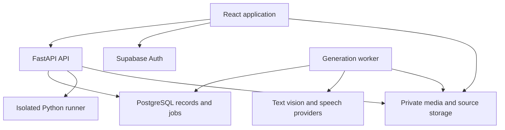
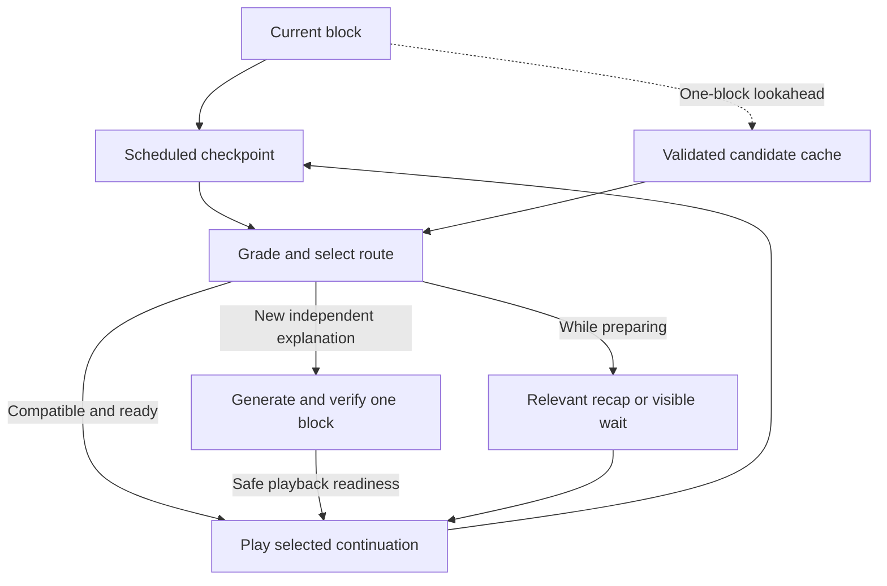

# BTP2 Teaching Platform Implementation Plan — College Project Revision

Prepared on 22 October 2026. All delivery dates use India Standard Time.

This plan takes BTP2 from its existing prompt-to-video engine to an English-language CSE learning platform with independent study, teacher-managed classrooms, complete lessons, scheduled assessments, Python practice, and persistent progress. It specifies implementation work and release evidence. It does not represent implemented changes or a deployment.

**Recommended design:** retain React, FastAPI, the provider adapters, and the Manim/FFmpeg engine. Add Supabase authentication and PostgreSQL, one durable generation worker, private object storage, a clip-based lesson player, and isolated Python execution. Plan the whole curriculum first. In Independent Study, generate the first teaching block and its checkpoint support, prepare one likely continuation ahead, and adapt subsequent blocks from assessment evidence. Reuse validated clips whenever possible. Classroom sessions select from fully teacher-approved content; novel generated content requires a new review before classroom use.

**What changed in this revision:** the independent learner no longer waits for every lesson video and branch to be rendered before starting. The player consumes completed scene clips, so final whole-video concatenation is unnecessary. One-step lookahead, a small reusable remediation library, simple deterministic routing, and visible preparation states replace an ambitious real-time generation system. The existing renderer stays; a new browser animation engine, custom streaming protocol, and complex autonomous agents are outside the deadline sprint.

**Experience promise:** feedback can be fast and a buffered continuation can start almost immediately. A genuinely new explanation generated after an answer has variable preparation time. The product must provide useful reviewed support or an honest wait in that case. Speculation reduces the frequency of waits; it cannot eliminate them or make free compute support 100 simultaneous unique generations.

**Delivery assessment:** completing and verifying the entire requested scope today is not a credible commitment from the current baseline. Treat 22 October as the integration milestone and 26 October as a gated deployment target. Every requested input remains part of the complete-release specification. If any required capability fails its gate, a deployment may be usable for its verified scope, but it must not be described as the complete requested release.

## 1 Confirmed requirements and planning assumptions

| Item | Decision |
| --- | --- |
| Team | Four developers; assign owners A, B, C, D below |
| Code baseline | Main branch is current; nothing deployed |
| Dates | Work starts 22 October; desired usable deployment 26 October 2026 |
| Audience | Approximately 100 students; model both 100 enrolled users and a 100-simultaneous-viewer test |
| Initial domain | English Python fundamentals; launch with three reviewed lessons on loops, functions, and list traversal/search; expand the CSE catalog after quality gates pass |
| Product sections | Independent Study and Classroom in the same application and account system |
| Inputs | Topic prompts, typed/pasted notes, PDFs, PowerPoint, scanned documents, handwriting, diagrams, and YouTube material |
| Video | Browser playlist of completed MP4 scene clips and checkpoint overlays; downloadable MP4 is unnecessary |
| Interaction | Pause/replay allowed; assessments appear at planned boundaries; no learner-initiated chat or voice interruption |
| Python | Python 3 practice; pinned interpreter and standard library initially; no arbitrary package installation |
| Adaptation | Rule-based assessment routing, cached remediation, and incremental generation of future independent-study blocks; classroom routes remain teacher-approved |
| Waiting | Longer initial preparation is acceptable; cached continuation should be nearly instant; uncached generation has visible progress and a useful fallback where available |
| Budget | Prefer free services; free operation is conditional on quotas and available compute, not guaranteed |
| Existing evidence | Repository code and documentation inspected; historical test/live-generation claims were not independently rerun |

The reference to quick answers is interpreted as feedback and hints at scheduled assessments. There is no open-ended question-answering chat in this release. This follows the later clarification that students should not interrupt with questions.

Use loops, functions, and list traversal/search as the initial content validation set. Binary search, recursion, and stacks/queues are subsequent catalog additions once the required visuals and reviews exist. These are testable CSE topics, not a claim of support for every university subject. Permit broader topics only with appropriate sources and successful review.

Lessons have no fixed one- or two-minute total length. Teaching objectives determine the outline and duration. Operational limits apply to individual uploads, generation batches, and costs; exceeding them creates another batch or a visible scope decision rather than silently dropping concepts.

### Feasible implementation boundary

| Build for the college deployment | Keep outside the deadline sprint | Why |
| --- | --- | --- |
| Complete curriculum outline, evidence, and assessment plan before playback | Generating an unplanned lesson one paragraph at a time | Prevent missing prerequisites or important objectives |
| One current teaching block and one likely future block | Rendering every possible student path | Bound generation cost and integration complexity |
| One common recap and equivalent check per concept, then add measured high-value variants | Three full difficulty versions of every lesson | Most content can be shared; error-specific variants are added only where useful |
| Existing renderer, complete scene MP4s, simple player prefetch | New browser animation engine, MSE/HLS pipeline, live TTS streaming | Reuse working code and avoid a second media stack |
| Planner, author, verifier, and at most two repair rounds as Python stages | Open-ended agent conversations, agent frameworks, a separate vector database | Make work bounded, debuggable, and easy to resume |
| Concept-level results, hint use, and known error tags | Research-grade knowledge tracing or an LLM judging every answer | Deterministic grading is faster and easier to validate |
| Real auth, classroom approval, Python grading, persistence, and deployed operations | Cosmetic dashboards or broad subject coverage before the core journey works | These are essential to a usable platform |

The **26 October candidate** is a working Python teaching service with both sections, the three reviewed launch lessons, topic/text/basic PDF authoring, checkpoint adaptation, Python practice, and persistent progress. It uses real accounts, media, and grading. Other requested input adapters remain explicit full-release work in section 6; only include them in this deployment when their tests pass. This is a deliberate deadline scope choice, not a claim that incomplete import support satisfies the original complete-release specification.

## 2 Current completion and reusable work

Reviewed commit: `de85cf1cec7554852d77c4f33d29bc05c3b38f31`, dated 7 October 2026. [R1]

| Component | Evidence in current repository | Assessment and action |
| --- | --- | --- |
| Frontend | `client/src/App.jsx`, generation controls and readiness components | Reuse API integration and job-status patterns; introduce routed account, classroom, authoring, and player screens |
| API | `server/main.py` | Reuse FastAPI; replace local single-owner assumptions with authenticated, authorized requests |
| Text and speech adapters | `server/providers/` | Retain provider boundary and explicit provider selection; benchmark models for teaching quality |
| Script schema | `server/script.py` | Exactly three scenes, 35-110 narration words per scene; replace total-lesson schema with a versioned concept graph |
| Visual schema | `server/visuals.py` | Four bounded templates; renderer also limits scene number and total to three; remove lesson-level caps while retaining safe per-scene bounds |
| Rendering | `server/manim_renderer.py`, `server/media.py` | Reuse fixed-template rendering, measured audio, and media verification; add instructional templates and timing cues |
| Recovery | `server/artifacts.py`, `server/runtime.py`, `server/owned_process.py` | Reuse artifact hashes, cancellation, and subprocess cleanup; move scheduling and authoritative state to PostgreSQL |
| Storage | `server/storage.py` | Atomic local files; replace with tenant-aware database records and private media objects |
| Authentication | Shared control token and loopback settings restrictions | Does not identify teachers/students or enforce course membership; real account authorization is new work |
| Learning loop | Standard video player | Checkpoints, grading, code editor, adaptive routing, and progress are new work |
| Sources | Prompt input only | All document and video ingestion flows are new work |
| Classroom | Absent | Course membership, review, publication, assignment, and reporting are new work |
| Tests | Tests for providers, recovery, controls, and media | Preserve these; add learning, tenancy, import, quality, and deployment verification |
| Operations | Local setup scripts | Cloud deployment, migrations, backups, monitoring, and incident procedures are new work |

The historical progress report records 50 passing tests and live generated videos. The generated media and private benchmark reports are not committed, so these remain historical evidence. The content review explicitly records unresolved factual and instructional errors. Successful rendering and valid JSON are not evidence that the lesson is suitable for teaching. [R2, R3]

Update `AGENTS.md`, README, and the implementation-status document when implementation starts: their existing instructions intentionally prohibit accounts, uploads, quizzes, and databases. The expanded product specification must replace that obsolete scope. This plan itself does not edit the repository.

## 3 Product workflows and permissions

### Independent Study

1. Sign in, open Independent Study, and choose a reviewed lesson or create a private lesson.
2. Submit one or several sources and a learning goal. Inspect extraction warnings and correct uncertain text, equations, or diagrams.
3. Confirm prerequisites, objectives, coverage outline, and estimated preparation work. A broad prompt such as “teach DSA” becomes a course outline with separate lessons.
4. Queue generation. Display completed stages, failures needing action, and a notification inside the application when ready.
5. Begin when the complete curriculum and assessment plan is validated and the first teaching block, its checkpoint, hints, common recap, and equivalent check are ready. Mark the lesson as partially prepared, not fully generated.
6. While the learner watches, prepare one likely next block. At a checkpoint, grade immediately, use a suitable cached continuation if available, or queue a bounded personalised block. Show prepared feedback and a relevant recap while it is prepared; preserve the option to wait or return later.
7. Save and resume; inspect completed objectives, assisted completions, and topics needing revision.

Private generated lessons carry an accurate review status. An automated check is labelled as automated validation; it is never presented as teacher approval. A reusable catalog contains explicitly reviewed lessons. Independent users can report an error and retire or regenerate their own lesson versions.

### Classroom

1. An administrator grants teacher privileges; users cannot obtain these by choosing a signup dropdown.
2. A teacher creates a course, opens a revocable enrolment code or roster-based invitation, and manages membership.
3. The teacher creates a lesson or forks an eligible independent lesson into a classroom draft.
4. Review the complete lesson sources, coverage map, script, diagrams, assessment keys, rubrics, hints, base explanations, and the small set of reachable remedial variants. Correct problems before final rendering where possible.
5. Preview final narration, synchronization, captions, and lesson paths; approve an immutable version.
6. Publish and assign that exact version. Set due dates if useful; students see only published material for their enrolled courses.
7. Inspect assignment progress, misconceptions suggested by assessment results, and items requiring help. Unpublish defective material and create a corrected version.

Classroom adaptation changes the sequence and amount of approved teaching content. Do not generate a new explanation and present it under an existing teacher approval. If an unsupported misconception appears, use an approved general recap, retain a help flag, and let the teacher add a reviewed variant later. Rendering and review can proceed block by block during preparation, but assignment waits for all reachable required classroom assets. This uses the longer initial wait the user accepts to protect teaching reliability and classroom playback latency.

| Role | Independent section | Classroom section |
| --- | --- | --- |
| Student | Own sources, lessons, attempts, and progress | Enrolled courses and their own assignments/results |
| Teacher | Own independent workspace | Own courses, review/publish/assign, enrolled students' classroom results |
| Administrator | Operational access only when needed and audited | Teacher verification, abuse management, and service configuration |

A teacher cannot inspect a student's private independent lessons through course membership. Course membership is a relationship, not a global student/teacher switch. One person may teach one course and be a student in another.

## 4 Architecture to implement

Use a modular monolith: one application repository and one backend codebase, deployed as an API process and a separate generation worker. The execution sandbox is a separate trust boundary. Keep one primary database. Do not introduce Kubernetes, a separate service for every agent, or a vector database for this launch.

The browser receives narrowly scoped temporary media URLs after an authorization check. It never receives storage secrets, runner credentials, answer keys, or provider API keys.

| Job | Choice | Reason |
| --- | --- | --- |
| Frontend | Existing React/Vite; React Router; plain existing styling | Preserve working code and give the two sections clear routes |
| API | Existing FastAPI and Pydantic | Reuse current Python integrations and validation |
| Authentication | Supabase Auth with Google sign-in as first provider | Managed sessions; avoids building password storage and initial SMTP dependence |
| Data | Supabase PostgreSQL, SQL migrations, RLS | Accounts, enrolment, lesson versions, jobs, and progress together |
| Jobs | PostgreSQL jobs table, one worker, leases, three priorities, and deduplication | Durable preparation with a small integration surface and no separate queue service |
| Agent workflow | Explicit persisted Python stages using existing provider adapters | Planner-author-verifier-repair behavior with visible outputs and bounded work |
| Rendering | Existing Manim/FFmpeg per-scene clips; one new code/variable/array trace template | Reuse actual animated video; make each clip available without waiting for a final concatenated MP4 |
| Narration | Existing Piper for low-cost batch narration; Gemini speech when evaluated and budgeted | Audio is prepared once and reused; pronunciation and quality still need listening review |
| Documents | Docling for PDF layout/OCR; python-pptx for slide text/notes; raster previews and vision extraction for difficult regions | Common evidence model across text, tables, scans, and figures |
| Media | Private S3-compatible object storage, initially Cloudflare R2 Standard | Keeps video traffic off the API and avoids relying on API local disk |
| Python editor | CodeMirror with Python mode | Suitable editor with a small integration surface |
| Python execution | Managed Judge0-compatible service with verified isolation and sufficient quota | Keep untrusted code off the API and rendering hosts |
| Progress updates | Poll preparation every 3-5 seconds; every 1-2 seconds only while an active learner awaits a block | Adequate for asynchronous preparation; no socket service required |

Google OAuth setup, audience settings, and real student-account login must be tested before inviting the class. If email/password is added, configure a real SMTP provider for verification and reset emails; Supabase's default mailer is restricted and unsuitable for general student onboarding. [R8, R9]

## 5 Durable incremental generation and publication

The generation worker claims one job atomically with `FOR UPDATE SKIP LOCKED`, writes a lease and fencing token, then commits the claim before running expensive work. PostgreSQL documents this locking option for queue-like access; it is one primitive, not an entire reliable queue implementation. [R10]

Implement these behaviors:

- States: queued, running, waiting_for_input, waiting_for_review, failed, cancelled, completed. Keep lesson publication state separate.
- Heartbeat every 15 seconds; proposed lease 90 seconds. A sweeper can reclaim an expired job. A stale worker must fail a fencing-token check before publishing any state or final manifest.
- No database transaction remains open during model inference, OCR, speech generation, or rendering.
- Each stage saves its output, validation result, source/model/prompt versions, and artifact checksum before advancing.
- Use bounded exponential backoff for transient provider errors; at most two content-repair rounds per unit. Persistent failure becomes an actionable review item.
- Claiming is at-least-once. Content-addressed artifacts and idempotent state changes make retries safe; do not promise exactly-once provider billing after a network ambiguity.
- Cancellation stops owned subprocesses and stops admitting new model calls. Already-running remote inference may finish; its result must not publish a cancelled lesson.
- Apply per-user admission limits and a global generation limit. Start with one heavy rendering job per worker and raise it only after memory/CPU measurements.
- Expensive source parsing and rendering must not share the student API request executor.

Use three queue priorities: a continuation needed by an active learner; one-block lookahead for an active session; then bulk lesson preparation. Use age and a maximum consecutive priority-job count to prevent starvation. Priority takes effect at the next safe stage boundary; an in-progress provider call or render is not instantaneously preemptible. Complete or cancel it safely, retaining only valid artifacts. Disable lookahead when active learners are already waiting or the daily budget is exhausted.

The speculative limit is **one candidate per active session, shared when equivalent**, with a small global queue limit chosen from measurements. Do not create one render job per viewer of a shared lesson. A unique job key coalesces identical requests; multiple sessions reference the same authorized artifact. A learner who disconnects or changes branch releases their interest. Cancel queued speculation with no consumers; already completed, valid work may remain cached under its normal scope.

Separate curriculum, availability, and review state:

- A confirmed curriculum version contains the complete required objective graph, source versions, notation, assessment plan, and coverage obligations. It does not imply that every video exists.
- Independent lesson availability is `planning`, `preparing_first_block`, `playable_partial`, `ready`, or `needs_attention`. `ready` means the canonical base route and required checkpoint support have been generated and validated; personalised variants may still be generated later. Learner completion is a separate state.
- Each teaching block records `planned`, `authoring`, `verified`, `rendering`, `playable`, `ready`, or `failed`. `playable` requires its verified script, checkpoint/hint/recap support, and sufficient completed clips; `ready` means all clips and support assets exist. A ready first block is required to start an independent session.
- Each clip is exposed only after complete audio/video production, decoding and duration checks, captions, checksum, upload, and authorization metadata are committed. Never serve a file while FFmpeg is still writing it.
- A session pins the curriculum version and immutable block versions. Add newly ready assets through a manifest revision. Never replace a clip under a learner's current playback position.
- Classroom publication is atomic only after every reachable required block, recap, check, caption, and asset has passed the appropriate teacher review. Adding a variant creates a new reviewable lesson version.

An independent block can become available incrementally after its whole script and examples pass verification. Release the first completed clip while producing later clips only when the measured production rate and current buffer make sustained playback credible. Otherwise wait for the whole block. The day-one implementation should default to complete-block admission; enabling earlier clip admission is a measured optimisation, not a release prerequisite. This keeps the code path small and avoids converting a short initial wait into repeated stalls.

Existing local artifacts are worker caches, not the source of truth. Completed outputs go to object storage. A worker restart must not interrupt ready clips or lose attempts. It can block the ungenerated remainder of an independent lesson; disclose that condition and allow safe resume. Fully prepared classroom lessons remain playable without the generation worker.

## 6 Input support for the complete release

All requested input categories remain release work. “Supported” means successful extraction on the validation set, preserved references, a usable correction flow, and honest handling of unreadable material. It does not mean perfect automatic interpretation of every damaged scan or handwriting sample.

| Input | Implementation | Required validation and fallback |
| --- | --- | --- |
| Topic prompt | Match to a curated CSE source collection; retrieve relevant authoritative sections; propose scope and prerequisites | Do not fabricate citations. If there is insufficient source evidence, request material or keep the draft unready |
| Typed notes and text | Preserve headings, code blocks, tables, and source block IDs | Source preview before generation; record contradictions or missing prerequisites |
| Digital PDF | Extract layout-aware text, tables, images, page numbers, and bounding boxes | Compare page count and meaningful content; detect empty pages and reading-order errors |
| Scanned PDF | Render pages, run OCR, preserve page images and recognition confidence | Side-by-side image/text correction; unresolved critical symbols block affected lessons |
| Handwritten notes | Page or image upload; vision-assisted transcription and structure extraction | Require confirmation for uncertain notation, code indentation, numbers, and formulas; no guessing silently |
| PowerPoint | `.pptx` text, tables, speaker notes, and slide images; interpret diagrams from rendered slides | Preserve slide numbers. Legacy `.ppt` uses a sandboxed conversion path; validate conversion before claiming support |
| Embedded diagrams | Retain original crop, caption, labels, arrows, and an editable interpretation | Verify direction, values, units, and relationship meaning; do not replace a complex figure with an unrelated generic flowchart |
| Public YouTube | Gemini's documented public-URL video-understanding route, processed in timestamped sections | Validate accessible video and time ranges; retain derived notes as interpretations rather than claiming an exact transcript |
| Other YouTube cases | Accept uploader-supplied transcript or permitted source media, preserving original URL/timestamps | Private/unlisted, unavailable, or preview-service failures require this fallback; no false claim that the URL was read |

Docling provides layout/OCR and visual-model integration, but handwriting and diagram correctness need their own validation. [R11]

The current Gemini documentation supports public YouTube URLs and labels the feature preview. It documents a free-tier YouTube input limit of eight hours per day. This is a dependency risk, not an unlimited import promise. The YouTube captions-download API separately requires permission to edit the video. Do not build the product around unauthenticated transcript scraping. [R12, R13]

Normalize every source into evidence blocks: source ID/version, type, page/slide/timestamp, text, image reference, extraction method, uncertainty flags, and correction history. Keep the original source available to its authorized owner and reviewers.

Suggested resource defaults: 25 MB per document or image collection; 200 pages/slides per processing batch; one hour per video batch. These are configurable admission bounds. Larger material is split into explicit batches, with all selected content tracked. Never truncate input silently to fit an LLM context window.

Validate content type and file signature, expanded archive size, parser time and memory, encryption, and corrupted inputs. Run conversion/OCR in restricted workers without application credentials. Keep macros and embedded executables disabled. URL processing uses approved hosts or a vetted retrieval service; do not let user URLs reach internal network addresses.

## 7 Lesson quality and the agentic workflow

Use a bounded workflow combining planning, specialist generation, evaluation, and repair. These are established engineering patterns, but the specific educational system is a proposed design requiring evaluation. A framework name or multiple model votes do not establish truth. Anthropic's workflow guidance supports this distinction. [R4]

Implement ordinary typed Python stages in this release. LangGraph is an optional later orchestration replacement if branching and debugging demands justify it; adding both graph persistence and a separate orchestration system now would increase integration work without proving better lessons.

| Stage | Input and output | Completion condition |
| --- | --- | --- |
| 1 Source audit | Evidence blocks to section inventory, missing/contradictory material, supported scope | Every selected section accounted for; critical extraction issues resolved |
| 2 Curriculum planning | Inventory and learner level to objectives and prerequisite DAG | No prerequisite cycles; each objective has evidence and a reason to be included |
| 3 Coverage planning | Objectives to explanations, examples, visuals, checks, and remediation needs | Every required objective maps to teaching content and an assessment |
| 4 Concept authoring | Source packet and shared notation to detailed script, worked examples, and visual specification | Explains assumptions, steps, examples, and common mistakes at the requested level |
| 5 Assessment authoring | Objectives to MCQs, trace questions, Python tasks, variants, and hint ladders | Answer keys and test cases exist; task is solvable from the lesson and declared prerequisites |
| 6 Independent verification | Draft, original evidence, and rubric to factual, coverage, pedagogy, and consistency findings | No unresolved critical findings; deterministic checks pass |
| 7 Bounded repair | Specific findings to revised affected units | Recheck the changed units and dependent questions/visuals; stop after two repair rounds |
| 8 Editorial review | Block draft and whole-lesson coverage context to accepted script or changes | Teacher reviews classroom material; independent material retains its truthful validation status |
| 9 Media production | Accepted block script to speech, animations, captions, and playable clips | Each exposed clip passes timing/decode checks; complete-block readiness includes checkpoint support |
| 10 Availability or publication | Validated block assets to a new immutable manifest revision | Independent availability can advance block by block; classroom publication waits for final review of every reachable required asset |

Run stages 1-3 for the whole lesson before playback. Prepare the assessment questions, deterministic keys, hints, equivalent checks, and source packets early, so a submission does not wait for question generation. Repeat authoring, verification, repair, and media production for one teaching block at a time. The table describes logical responsibilities, not ten autonomous services.

For an independent continuation, the author receives the next required objective, relevant evidence, previous block summary, shared notation, completed objectives, and a compact assessment summary. That summary contains failed objective/test categories, hints used, and whether a prerequisite recap was completed. Do not send unrelated student records or the complete chat history. Use a normal or reinforced explanation profile and, where supported, one dominant misconception tag. A single answer is evidence for a route, not a reliable diagnosis of overall ability.

Generation may add explanation and worked examples, but cannot silently remove objectives, relax assessment keys, or change prerequisites to manufacture a pass. The verifier checks new content against the fixed blueprint and the material already taught. Text can be adapted for an individual while assessments remain stable and validated. Newly generated independent content is labelled automatically validated until a human reviews it.

Reviewer calls must receive the original evidence, not only the author's explanation. A different model can reduce some shared errors but is not a correctness guarantee. Use a stronger verified model for difficult content if available; never promote the current small local model to automatic trusted publication merely because it runs for free.

Model selection is a day-one benchmark task: test the existing local candidate and available cloud candidates against the same CSE examples, then pin exact model IDs and prompt/schema versions. Judge factual accuracy, source fidelity, explanatory depth, example continuity, assessment correctness, failure rate, and preparation cost. Preserve every result, including failures. Provider availability and SDK compatibility must be checked in the actual project account.

### Coverage contract

For each required objective, retain: prerequisite IDs; evidence references; explanation scene IDs; at least one worked example; a concept-appropriate visual; assessment IDs; remediation IDs; and review status. Examples must keep the same input values and notation across narration, pictures, and code.

Track planned, authored, validated, rendered, viewed, and assessed coverage separately. A planned scene ID does not count as delivered instruction. A session cannot show the whole lesson as completed while required objectives remain ungenerated, unseen, or unresolved. Run generated Python worked examples and reference solutions in the isolated runner, checking outputs and trace values against the narration; model agreement alone is insufficient.

Coverage is measured against the approved scope. It cannot mean “all knowledge about a subject.” When a source omits an essential prerequisite, add a sourced bridge or ask the author to supply it. A coverage percentage measures mapping completeness, not proven learner understanding.

Do not force a whole chapter into one prompt or decide the length by a target number of scenes. Create a chapter map, then complete each concept with bounded model calls. A long concept can contain several explanation scenes. Split very broad requests into a course of lessons while preserving the complete objective inventory.

### Media quality contract

- Retain existing process/cycle/tree/plot templates. For the college launch, add one reusable code-and-state template supporting line highlights, variable values, and short array/list traces. Defer call-stack and equation templates until a launch topic actually needs them; do not select unsupported topics merely to widen the catalog.
- Use a safe scene-description schema. Do not execute model-written Python, HTML, or JavaScript as a renderer.
- If no template represents a concept accurately, combine a permitted source figure with annotations or hold the draft for author correction. Do not force it into a misleading diagram.
- Break narration into semantic utterances. Measure each utterance's audio, then associate visual events with those boundaries. Use measured cue timing rather than dividing the entire audio evenly among animations.
- Generate captions and an accessible transcript from the approved narration. Listen for pronunciation, missing sentences, unexplained symbols, pacing, silence, and clipping.
- Target 720p with legible labels and code on a typical laptop and mobile screen. Offer a lower-bandwidth rendition if measured playback needs it; preserve educational content.
- A visual-inspection or vision-model check can flag overlap and mismatch, but classroom approval includes human review of the rendered output.

## 8 Adaptive playback with bounded preparation

### What is generated when

A **teaching block** explains a coherent concept or sub-concept and ends at a planned checkpoint. It can contain any number of **scene clips**. Scene clips are delivery units, not a limit on explanation length. Reuse natural scene boundaries; a 30-90 second clip is an initial tuning range, not a hard rule. Do not split a worked example at a confusing point to satisfy a timer. There is no fixed total lesson duration.

| Moment | Work | Learner experience |
| --- | --- | --- |
| Before starting | Validate the whole curriculum, sources, assessment plan, keys and hints; generate the first block plus its common recap and equivalent check | Honest initial preparation screen; all required objectives visible |
| While watching the current block | When capacity permits, prepare the normal next block or a reinforced block suggested by earlier results | Normal playback; no extra task for the learner |
| At a checkpoint | Grade deterministically; update concept evidence; choose a compatible cached block or queue one bounded continuation | Feedback appears without waiting for the video generator |
| If the chosen route is ready | Authorize, preload, and switch to its completed clips | Fast continuation, subject to actual buffering |
| If a new independent block is needed | Author and verify that block, then produce its audio and clips; continue from the earliest safe readiness point | Relevant prepared recap or optional practice; otherwise an explicit preparation state with save-and-return |
| At the next concept boundary | Repeat with the updated evidence, preserving all required objectives | Explanations can change in depth and example choice without losing syllabus coverage |

The first-launch rule is one base explanation plus one common recap per concept, with fresh equivalent checks. For later concepts these are prepared as their block is prepared, not all rendered before the first block starts. Add extra misconception variants only after the small version is working and a teacher or repeated attempts justify them. Variants rejoin the same next required objective; avoid a branching tree of complete personalised lessons.

### Simple adaptation rules

1. Passing the current objective selects the next required objective with a normal explanation. It can skip an optional recap, never an unseen required concept.
2. A known distractor or failed Python test category selects its matching recap; otherwise use the common concept recap. Require the equivalent check before recording an unassisted pass.
3. After remediation, carry the relevant error tag into the next independent block where it affects the explanation. For example, an off-by-one error can lead to a more detailed index trace in the next loop example.
4. Prefer a validated compatible cached version. If no version fits, generate one independent block using the approved sources and shared blueprint. Do not produce an entirely new course after every answer.
5. After two unsuccessful retries, provide the worked solution and a revision/help route. Record assisted completion or an unresolved objective separately from a pass. Do not trap the learner in an endless loop or treat a shown solution as proof of mastery.

Classroom uses the same rules over its approved finite set of blocks. There is no live generative publication in a classroom session. Missing variants become teacher review work; the current session receives an approved general explanation or a help flag.

### Handling a wrong prediction

An unneeded lookahead block does not replace the route chosen from the actual answer. Keep it as a valid cached normal version if useful, cancel queued dependent work without consumers, and prioritize the selected continuation. Never silently play an inappropriate explanation just because it finished first.

The cached fallback must address the current objective or the learner's prerequisite gap. It can be a short reviewed recap, a replayed worked example, or optional relevant practice. It must be skippable and accurately labelled. Do not force repeated quizzes or stretch narration to conceal generation time. If no appropriate ready continuation exists, show preparation progress and allow the learner to leave and resume. No false countdown or promise that new content is already ready.

An illustrative sequence: a learner watches a four-minute loop block while the worker prepares a normal list-traversal continuation. A correct answer can use that candidate if it is ready. An off-by-one answer first gets the prepared boundary recap and an equivalent check; the next independent block can use a cached boundary-focused version or queue one. Four minutes is an example watching window, not a measured guarantee that the worker finishes inside it.

### Reuse and state consistency

Cache only verified artifacts. A cache key contains access scope, curriculum/source version, objective, explanation profile, misconception tag, prerequisite/notation context, assessment version, prompt/model/schema versions, language, voice, and render settings. Personal names and raw answers do not belong in reusable narration. Reuse across a course or explicitly shared catalog only when authorized; private independent sources stay private. Teacher approval is not inherited merely because an automated cache entry exists.

Store a monotonically increasing `route_revision` per session. Every continuation request records the attempt and route revision that selected it. On result arrival, the API checks that it is still the selected continuation. A stale job can populate an authorized cache, but cannot advance or overwrite the learner's current route. Switching tabs, retrying an answer, and duplicate callback delivery must not switch playback unexpectedly.

### Player implementation

1. Load a server-authorized session pinned to its curriculum version and current manifest revision. Support `preparing`, `playing`, `paused`, `checkpoint`, `submitting`, `feedback`, `waiting_for_block`, `ready_to_continue`, `complete`, and `recoverable_error` states.
2. Use ordinary completed MP4 clips with consistent codecs and dimensions. Do not concatenate the whole lesson before starting playback. Use a bounded next-clip buffer; accept a brief measured transition at scene boundaries rather than promising frame-perfect streaming.
3. Keep the active media element and one preload element. Prefetch the next scene and, near a checkpoint, the likely continuation or current recap within a small memory budget. Cancel obsolete downloads. Signed URLs must support tested range/CORS behavior and refresh before expiry.
4. Inspect actual buffered ranges, ready state, and playback errors. `preload="auto"` is a hint and may be ignored; neither a returned URL nor `canplay` alone proves a whole continuation is buffered. [R18, R19]
5. Pause at the scheduled checkpoint and show the assessment/editor in an accessible panel. Answer submission returns the grade and one of `ready`, `preparing`, `needs_review`, or `blocked`; generation never runs inside that HTTP request.
6. Continue is fast only when the selected media has buffered. While preparing, poll the selected continuation and show useful feedback. Start after complete-block readiness by default; enable earlier verified-clip playback only after the throughput test in section 15 passes.
7. Persist confirmed progress at clip boundaries and checkpoint results, plus a debounced playback offset and code draft. Restore the exact selected block and assessment state after refresh or sign-in; reject stale writes by revision.

Allow pause, replay, captions, speed control, and keyboard navigation. There is no open-ended learner chat. Enforce classroom checkpoint progression server-side. Watching, seeking, and finishing a video are separate from passing required objectives. Display unresolved objectives honestly even if the learner has viewed the entire route.

## 9 Assessments and Python execution

Use deterministic MCQ, multiple-selection, trace/output, and Python assessments for the first release. These cover the chosen subjects without putting an LLM on the pass/fail path. Free-form essay grading can be added later if a validated rubric and uncertainty-handling workflow are needed; it is not required by the clarified interaction scope.

For every assessment, save its immutable version, objective IDs, answer rules, public examples, hidden tests if applicable, misconception tags, hint ladder, equivalent variants, and passing rule. A proposed default is all essential checks passing and at least 80% of total weighted checks. This is a product rule, not a scientific mastery threshold.

Pre-generate hints in increasing specificity: identify the relevant idea, point to the faulty step, and show a partial worked example. Map objective failures or known distractors to prepared hints. Unexpected failures receive a useful generic prepared hint and an issue-report option; optional AI-written feedback must not delay grading or continuation.

Python submission design:

- The browser sends source code and an assessment version; the API supplies language/runtime ID, stdin fixtures, and strict execution limits.
- Use a separate managed runner. Never call `exec`, `eval`, or a Python subprocess on the API/generation server with learner code.
- Initial proposed limits: 2 CPU seconds and 5 wall-clock seconds per run, 128 MB memory where compatible with the pinned interpreter, 64 KB output, bounded files and processes, and networking disabled. Verify the selected host actually enforces them.
- Judge0 exposes networking and resource settings; its documented defaults are not necessarily safe. Set allowed limits server-side and test denial rather than relying on defaults. [R14]
- Keep expected outputs and grading logic in the trusted backend. No answer keys, hidden tests, runner tokens, or reference solutions in the normal lesson response.
- Begin with standard-library stdin/stdout exercises and simple function-completion wrappers. Define whitespace and floating-point comparison rules explicitly; use tolerances where appropriate.
- Test the reference solution, known wrong solutions, edge cases, timeouts, and equivalent correct implementations before publishing an assessment.
- Persist `submitted`, `running`, `graded`, or `service_failed` separately. Runner failure must preserve the draft and must not lower the student's result.
- Authenticate runner callbacks or poll server-side; use an attempt ID to reject duplicates and cross-user callbacks.

Capacity is driven by runs, not student count. For example, 100 students x 5 Python tasks x 3 submissions is 1,500 submissions, before accounting for separate runs per hidden test. Verify the provider quota and burst capacity for the actual test design. A tiny free runner allowance will not support this workload.

If a funded managed runner is unavailable, an institution-managed isolated runner is the alternative. Its isolation and load tests are still mandatory. Browser-only Python can assist local practice but cannot be the authority for classroom completion.

## 10 Data model and application contracts

Use migrations and database constraints from the start. The following table groups logical records; combine small tables if appropriate, but preserve version and permission boundaries.

| Record | Essential fields and constraints |
| --- | --- |
| Profiles and roles | Auth user ID, display name, approved platform privileges; no editable self-promotion |
| Courses and memberships | Course owner, member user ID, course role, status; unique membership |
| Sources and source versions | Owner/course scope, private object key, content hash, extraction state, source metadata |
| Evidence blocks | Source version, text/image reference, location, confidence/warnings, correction revision |
| Lessons and curriculum versions | Owner/course scope, title, complete objectives/prerequisites, source snapshot, immutable blueprint, separate availability and review/publication states |
| Concepts and edges | Objective IDs, prerequisites, base/remedial/extension type, valid transitions |
| Teaching block versions | Objective, normal/reinforced profile, supported misconception, evidence, script/assessment dependencies, verification status, production state |
| Assets and manifest revisions | Block and scene IDs, private object key, checksum, MIME type, duration, captions, cue timeline, dependency versions; append ready assets without overwriting active clips |
| Variant cache | Unique scoped content key, block version, validation/review state, existing job ID, active consumer references; no cross-private-source reuse |
| Assessments and private keys | Public question data separated from restricted answer keys, hidden tests, solutions, and rubrics |
| Review records | Reviewer, exact lesson version, coverage/media/assessment status, findings and approvals |
| Assignments | Course, published lesson version, due date, required objectives |
| Learning sessions | Learner, curriculum/manifest version, assignment if any, selected block and clip, playback offset, progress revision, route revision, selected continuation job |
| Attempts and drafts | Learner, assessment version, idempotency key, source/answer, state, score, feedback and timestamps |
| Objective evidence | First-attempt outcome, retries, hints, assisted completion, unresolved flags; no unsupported mastery claim |
| Jobs and stage results | Owner scope, type, priority, unique deduplication key, consumers, requested route revision, state, lease, fencing token, retries, dependency hash, outputs, error category |
| Usage and audit events | Generation/runner quota usage, role changes, approvals, publication, deletion, administrative actions |

Authorization must run on every API endpoint. Enable RLS on exposed database tables and private storage, with explicit tests for teacher and student boundaries. Backend secret credentials may bypass RLS, so service-level access still needs explicit scope checks. Supabase documents this distinction. [R7]

Suggested routes and contracts:

| API group | Operations and behavior |
| --- | --- |
| `/api/me` | Verify session; return allowed sections and server-trusted roles |
| `/api/courses` | Create/manage courses, membership, enrolment codes, assignments |
| `/api/sources` | Authorized upload session, finalize, status, extracted preview, corrections, deletion |
| `/api/lessons` | Scope proposal, whole-outline confirmation, first-block preparation request, list/detail/version and coverage status |
| `/api/jobs/{id}` | Authorized stage/progress view, cancellation, retry; return 202 for accepted asynchronous work |
| `/api/reviews` | Findings, approve exact version, publish/unpublish with access checks |
| `/api/sessions` | Start/resume pinned curriculum and selected blocks; progress updates with expected revision; server schedules bounded lookahead |
| `/api/attempts` | Idempotent submission; immediate objective result or asynchronous code-run state; select route and return continuation status |
| `/api/sessions/{id}/continuation` | Authorized selected route revision, `ready/preparing/needs_review/blocked`, job stage, ready asset IDs, and relevant fallback IDs; repeat reads do not duplicate jobs |
| `/api/assets/{id}/access` | Check owner/enrolment/publication, then issue short-lived media access |
| `/api/reports` | Own progress or teacher's classroom report; exclude private independent activity |
| `/api/issues` | Report wrong content, bad question, inaccessible asset, or playback failure |

Classroom publication is atomic. Independent block availability advances through manifest revisions only after validation, with each session retaining its selected immutable blocks. Teacher edits create a new draft version; existing sessions keep their pinned version unless a serious defect requires retirement. Never change an assessment key midway through attempts without an explicit regrade and audit policy. A grade and its route decision commit together; retrying submission must return the same persisted result and must not queue another generation.

## 11 Concrete repository changes

These are proposed implementation locations, not files already created.

| Current or proposed area | Work |
| --- | --- |
| `server/main.py` | Extract routers; JWT verification and authorization dependencies; remove shared control-token security as the multi-user identity mechanism |
| `server/script.py` | Introduce full curriculum, teaching block, scene, checkpoint, and transition schemas; remove the whole-lesson three-scene assumption |
| `server/visuals.py` | Remove three-scene lesson caps; add approved instructional templates and cue validation |
| `server/generator.py` | Split curriculum planning from `prepare_block`; validate before media work; expose completed scene clips; remove whole-video concatenation from the playback readiness path |
| `server/manim_renderer.py` | Retain templates; add one code/variable/array trace template; use semantic timing cues and test readable output |
| `server/media.py` | Verify each MP4, duration, captions and playback-compatible settings before upload; retain final concatenation only for legacy functionality |
| `server/storage.py` | Keep local cache helpers; add PostgreSQL repositories and object-store access |
| `server/providers/` | Preserve adapters; add ingestion/vision capability behind explicit contracts and pin tested versions |
| `server/auth/` | Session validation, role checks, course membership, asset access |
| `server/ingestion/` | Document readers, OCR/vision, source normalization, previews, corrections |
| `server/lessons/` | Whole-curriculum coverage, bounded block authoring/verification, scoped variant cache, review and manifest revisions |
| `server/assessment/` | Objective grading, runner integration, hint mapping, attempt lifecycle |
| `server/learning/` | Deterministic routing, one-block lookahead, selected continuation, route-revision checks, progress and resume |
| `server/worker/` | Claim/lease/heartbeat/recovery, three priorities, shared-job deduplication, admission limits and cancellation |
| `client/src/pages/` | Auth, section switch, independent library, course workspace, authoring/review, player, progress |
| `client/src/player/` | Clip playlist, bounded preload, checkpoint overlay, waiting/fallback states, captions, drafts and resume; no custom streaming engine |
| `migrations/` | Schema, permissions, RLS, indexes, seed roles and migration tests |
| `tests/` | Extend current suites with tenancy, import, workflow, adaptive-route and integration tests |
| `deploy/` | API/worker container definitions, health checks, environment examples and restore/runbooks |

Keep existing generated MP4s as legacy view-only assets if migration is needed. Do not fabricate objective coverage or assessment history for them. Regenerate them as versioned lessons before assigning them in the classroom.

## 12 Four-person ownership and dependency order

| Owner | Primary responsibility | Acceptance evidence |
| --- | --- | --- |
| A | Accounts, database, courses, API authorization, worker durability, deployment | Real users sign in; isolation and lease recovery pass; deployed API and restore procedure work |
| B | Sources, full curriculum, block authoring/verification, review APIs and launch content | Complete objective map; grounded blocks; three reviewed Python lessons; input support tracked honestly |
| C | Per-scene media output, code trace template, captions, player and preload | No whole-video render barrier; cached route starts quickly; waiting and resume work without stale playback |
| D | Assessments, runner, routing/progress, cache/lookahead decisions, integration and basic reports | Trusted grading; one selected continuation; deduplication and wrong-prediction cases pass |

Each owner also builds the frontend slice of their feature; do not leave all screens to C. Pair B and C on lesson/scene contracts, A and D on access control and attempt transactions. One designated integrator merges small reviewed changes throughout the day.

Agree these contracts before parallel coding: evidence-block schema, curriculum and teaching-block schemas, manifest revisions, assessment public/private split, attempt result, continuation status, route revision, deduplication key, and permission matrix. Use one shared test lesson fixture so integration can proceed before generation is ready. Fixture playback is development evidence only; launch acceptance requires actual generated and reviewed content.

The critical path is accounts/schema -> complete curriculum and first playable block -> trusted assessment -> cached and uncached continuation -> teacher-approved classroom lesson -> deployed verification. Rich input extraction and content review are additional workstreams. Deploy staging on day one so infrastructure problems do not arrive on the final evening. Preserve the narrow end-to-end path before starting more templates or import adapters.

## 13 Work schedule through 26 October

This is an aggressive plan for the scoped college deployment defined in section 1, not a promise that the entire original input specification fits five days. No requirement is counted as done because a button exists or a mock response renders. Use feature flags to keep incomplete adapters and unverified generation paths out of the student interface.

| Date | A | B | C | D | Integration outcome |
| --- | --- | --- | --- | --- | --- |
| 22 Oct | Auth, roles, core schema/RLS, staging skeleton | Curriculum/block/assessment contracts; topic/text/basic PDF extraction | Remove lesson scene cap and final-concat readiness barrier; clip player | Objective grading, attempt contract, runner proof, progress | Authenticated fixture journey on staging; real generation can produce and expose one verified block |
| 23 Oct | Courses, enrolment, assignments, private assets and job leases | Grounded block authoring, verifier/repair, first complete reviewed lesson | Checkpoint panel, code trace template, captions and next-clip prefetch | Python grading, prepared hints, recap/check routes and cache lookup | A real generated lesson works from first block through assessment and continuation; classroom approval enforced |
| 24 Oct | Three job priorities, deduplication constraints, limits, backup | Remaining launch lessons; test normal/reinforced blocks against coverage | Honest waiting/fallback screen, refresh/resume and signed-URL renewal | One-step lookahead, route revisions, stale/duplicate results, basic teacher report | Cache hit, cache miss, wrong prediction, worker outage, and classroom-only-approved routes verified |
| 25 Oct | Production config, restore drill, authorization and capacity tests | Full launch-content review; fix factual, source and assessment defects | Full audiovisual review, browser/mobile checks and clip-gap measurements | Sandbox, shared-checkpoint load, retry/recovery and learner pilot | Feature freeze; measured release candidate with no unresolved critical defects |
| 26 Oct | Release, migrations/rollback, monitoring | Final content approval and input-support declaration | External-network playback and checkpoint checks | Real teacher/student smoke tests and handover | Open the verified college service; retain incomplete full-release work and actual performance limits |

### Today in four integration blocks

1. **First 60-90 minutes:** agree schemas, routes, ownership, review rules, host availability, provider accounts, and the Python runner. Pin the baseline and establish a shared fixture.
2. **Next 2-3 hours:** implement account and permission foundations in parallel with evidence, player, and assessment interfaces. Get staging reachable.
3. **Next 3-4 hours:** integrate a first block, its assessment/recap, one continuation, Python submission if the runner is ready, saved progress, and the teacher publication boundary. A fixture may unblock UI development; replace it with actual generation before calling the journey verified.
4. **Final 60-90 minutes:** run the integrated journey with separate teacher/student accounts; record actual blockers and commit the runnable state.

These blocks assume substantial uninterrupted developer time and may exceed the hours remaining today. Do not claim the platform is complete at the end of this milestone. Extra developers, AI-assisted coding, or longer working hours do not remove the need for content review and isolated-execution verification.

### Effort sanity check

The scoped college deployment has a rough planning allowance of **18-26 person-days**, assuming the existing renderer works on the chosen host, managed auth and runner setup are available immediately, and the team can integrate in parallel. This is an estimate, not measured velocity. Four people across 22-26 October have at most 20 person-days even at a full working day each per date, so the target remains tight and has little contingency.

The earlier estimate for all requested import types, richer media, and complete operational verification was 34-53 person-days. Incremental scheduling, cache consistency, and waiting-state tests add roughly 2-4 person-days that the old prepared-only plan did not include. Treat **36-57 person-days** as the provisional full-scope estimate until day-one integration provides better evidence. Do not add these full-scope days again to the core estimate; the core is included.

On 23 October, record actual first-block preparation time, time for a new continuation, authoring defects, integration progress, provider quotas, and remaining hours. Re-estimate from that evidence. If the core is behind, defer early-clip admission and lookahead optimisation before weakening auth, grading, coverage, or classroom review. Complete-block incremental generation with visible waits remains a valid implementation; an unverified instant-play promise does not.

If every requested input must be in the first public release, hold that release until section 17 passes in full. The 26 October deployment can then be a restricted pilot for the verified core. Do not silently drop handwriting, diagrams, or YouTube while claiming the original complete release is finished.

## 14 Free-first deployment and capacity

### Preferred arrangement

| Component | Deployment | Conditions |
| --- | --- | --- |
| React frontend | Cloudflare Pages free plan | Use provider subdomain initially; media belongs in object storage |
| Authentication and records | Supabase free project initially | Monitor database, egress, and activity limits; maintain your own tested backup/restore procedure |
| Video and source objects | Private R2 Standard bucket | Meter storage/operations; account activation/billing requirements must be checked during setup |
| Student API | Institution-provided always-on host; otherwise a small paid always-on FastAPI host | No rendering in the request service; student latency must be measured on the actual host |
| Generation worker | Existing suitable team/college machine with outbound connectivity | Ready content continues from storage when offline; ungenerated independent continuations wait; schedule active generation only when capacity exists |
| Python grading | Funded/credited managed runner or institution-managed isolated service | Adequate submission quota, separate isolation, verified resource/network limits |
| Text/vision/speech | Available model allowances plus existing local speech/rendering | Free quotas are metered; keep a project budget ceiling and admission controls |

Supabase's published free allowance currently includes 50,000 monthly active users, a 500 MB database, 1 GB file storage, and separate 5 GB uncached/cached egress allowances; inactive free projects can pause after a week. These limits do not establish a performance guarantee for 100 concurrent users. [R5]

R2 Standard currently includes 10 GB-month storage, one million Class A operations, and ten million Class B operations per month, with no internet-egress charge. These are storage/operation allowances, not free compute or unlimited storage. [R6]

Cloudflare Pages has a 25 MiB per-asset limit, reinforcing the decision to put source documents and media in private object storage instead of frontend deployments. [R15]

Render Free can sleep after 15 minutes without inbound traffic and take about a minute to wake; local files are ephemeral. Its own documentation advises against production use. Do not promise almost-instant assessment feedback with this as the only student API host. Use it for staging if useful. [R16]

Google OAuth with minimal profile scopes is the default account path. If college policy requires password-based accounts, configure SMTP and test verification/reset flows; disabling verification to meet a deadline is not the solution.

### What zero cash actually requires

Zero additional cash may be possible if the institution supplies an always-on API host and an isolated runner, the team supplies generation hardware, and media/AI usage stays within available allowances. Hardware, electricity, administration, and service availability still have costs.

Without those resources, prioritize a small budget for the always-on API and Python runner before paying for decorative video generation. A provisional contingency envelope of **INR 2,000-5,000 per month** can be discussed for initial hosting/runner/AI use with existing generation hardware. This is an engineering planning allowance, not a verified provider quote or proof that the workload fits it. Actual account quotes and measured usage determine the budget.

The Gemini pricing documentation distinguishes limited free access and free-tier data use from paid-tier conditions. Do not send confidential student or college material to a free provider route until its data-use conditions are acceptable; retain an explicit provider policy and disclosure. [R17]

### Workload model

- A 30-minute video at an assumed average 1 Mbit/s is about 225 MB. One viewing by each of 100 students transfers about 22.5 GB. This is an estimate; measure actual rendered bitrates.
- Ten lessons with 30 minutes of base content and 20 minutes of cached variants each would occupy about 3.75 GB at that bitrate, excluding sources, alternate renditions, and temporary artifacts. Incremental generation delays this storage use; it does not eliminate it.
- One hundred simultaneous viewers at that bitrate need roughly 100 Mbit/s of media delivery before overhead. Serve that directly from media storage/delivery infrastructure, not the FastAPI instance.
- One hundred enrolled users do not imply 100 concurrent video generations. A classroom plays shared approved assets and normally needs no live generation. Admit independent preparation into a visible queue; begin with one heavy worker and one admitted uncached active continuation at a time, then raise this measured limit if justified.
- During class, route assessment results to approved shared variants. If 100 independent sessions request the same authorized continuation, coalesce them into one job. If they request 100 genuinely different continuations, cap admission and show the wait; a single free worker cannot promise instant service.
- Initially allow at most one queued speculative candidate per active independent session and a configurable global cap of two such candidates. The worker renders only one heavy unit at a time. Increase this only when hit rate, wasted work, queue age, and provider limits support it.
- Record source size, rendered minutes, model input/output tokens, speech usage, render CPU time, storage, egress, and runner executions per lesson. Include retries and remedial branches.

Budget formula: API hosting + runner hosting/submissions + model input/output and vision + speech + render compute + stored GB-month + storage operations. Shared classroom lessons amortize generation over the class; independent one-off lessons do not.

Use a configurable initial independent-generation quota, such as one active lesson-generation session per student and an administrator-set daily project budget. Its current required work and optional lookahead share that budget. Prioritize a current continuation over that user's speculation. Do not publish a numerical daily generation promise until preparation costs and available quotas have been measured.

## 15 Performance targets and measurement

These are proposed acceptance targets, not current performance claims. Measure p50/p95 with sufficient samples, report failures and cold starts, and specify network and workload conditions.

| Interaction | Proposed target | Method |
| --- | --- | --- |
| Pause and checkpoint overlay | Local response within 100 ms | Browser event and first-visible-frame timestamps |
| Objective assessment feedback | p95 below 500 ms on a warm API | Server-received submission to committed result delivered |
| Prepared hint display | p95 below 300 ms when authorized data is loaded | Click to visible hint |
| Normal Python grading | p95 below 5 seconds at the supported submission load | Include queue time, execution, and result persistence; report timeout exercises separately |
| Cached Continue after grading | p95 below 500 ms for an actually prefetched selected block | Continue click to first audible/visible playback; report the percentage of attempts eligible for this fast path |
| Uncached independent continuation | Measure and publish the actual wait; no instant-play commitment | Submission to verified first playable clip and to complete-block readiness, including queue, authoring, verification, TTS, rendering and download |
| Clip boundaries | Proposed p95 transition gap below 750 ms on the declared test setup | Last audible/visible content of one clip to first of the next; measure slow-network and mobile failures separately |
| Initial published-lesson playback | p95 below 3 seconds on the declared test connection | Session start to first playable media |
| Generation | Show phase and queue position; no unmeasured fixed completion promise | Separate extraction, planning, verification, speech, render and review time |

Record end-to-end wait distributions for **all** checkpoints, cache-hit rate, prediction hit rate, speculative work wasted, fallback use, learner abandonment while waiting, and render seconds per finished media minute. A good latency number for cache hits alone does not prove the product feels smooth.

For a candidate prepared in advance, the remaining wait is approximately `max(0, time until candidate is ready - useful preparation head start)`. Include queue time and transfer in the readiness time. A newly personalised candidate requested after the answer has no pre-answer head start unless a compatible version already exists. Prepared feedback can overlap production, but the learner must not be forced to sit through extra work to improve this metric.

On 23-24 October benchmark at least normal, reinforced, and failed/retried generation on the actual host. If one block usually takes longer to prepare than the previous block takes to watch, one-step lookahead will not sustain playback. First reduce render complexity while preserving readable teaching, improve reuse, or prepare another known block during the accepted initial wait. If still insufficient, keep complete-block readiness and disclose waits, or obtain more compute. Do not attempt a custom streaming stack as an emergency fix for slow generation.

Earlier clip admission is optional. Enable it only after repeated runs show production staying ahead of consumption with buffer headroom, including the selected playback speed, network transfer, queue contention, and provider retries. Until then, start each new block only once it is fully ready. Never claim that producing the first clip quickly guarantees the rest can keep up.

Test 100 concurrent classroom viewing sessions with progress writes and a shared checkpoint. Check that cache misses for identical authorized requests create one job; separate private-source requests must not coalesce. Also test a burst of 20 Python submissions and the full 100-person synchronized checkpoint with realistic retries. For independent generation, report the measured admitted concurrency separately from viewing capacity and verify that excess requests queue honestly.

Use loading/retry states for a slow connection or unavailable grade. Preserve code and prior progress. A buffering failure is not a grading failure. Never mark a failed submission as wrong merely to advance the interface.

## 16 Security reliability and operational completion

Authentication verifies signature, issuer, audience, expiry, and current membership. Use trusted role records, appropriate session refresh, narrowly configured redirects/CORS, and rate limits. Keep keys in host-managed secrets, not browser settings or the repository.

Private asset access must enforce the same scope as its lesson/source. Temporary media links expire; do not expose permanent public classroom uploads. Restrict caches to the authorized tenant scope and include lesson/source/model versions in cache keys. Do not deduplicate private content across users in a way that leaks its existence.

Treat uploaded instructions and generated text as untrusted content. They cannot change permissions, runner limits, review requirements, or publication state. Escape output and restrict rendered markdown/HTML. Keep answer keys out of logs and client payloads.

Maintain concise operational metrics: API error/latency, active sessions, queue age by priority, stalled leases, worker heartbeat, generation failure by stage, selected-route wait, cache/prediction hit rates, wasted speculation, provider quota, media failures, runner queue/timeouts, storage usage, and unresolved content reports. Logs use IDs and error categories; redact source content, code, and tokens by default.

Back up database records and object manifests at least daily during the launch, with a documented retention policy and access controls. A database backup is not a backup of media objects. Verify restoration of both in a separate environment. Proposed launch targets: recovery point within 24 hours and service recovery within four hours; these remain unproven until the drill passes.

Provide upload/lesson/account deletion behavior and explain retained classroom records and backup expiry. Retire published lessons rather than deleting assets still used by active sessions without a controlled migration. A serious content defect can suspend affected assignments immediately.

At least one team member owns operations after 26 October: reviewing content issues, checking quotas, restarting/replacing the preparation worker, restoring service, rotating secrets, and applying security updates. A usable deployment includes this ownership.

## 17 Release acceptance matrix

Every row is required for the original complete release. The scoped 26 October candidate must pass all core rows and describe its supported inputs and concurrency accurately; it is not the original complete release while full-scope rows remain open. Attach evidence to a tracked task: test report, reviewed lesson version, screenshot/video of the journey, or restoration log. “Implemented” and “verified” are separate statuses.

| Gate | Required evidence | Owner |
| --- | --- | --- |
| Accounts | Real teacher and student sign-in, logout, refresh, revoked membership; password recovery if passwords enabled | A |
| Isolation | Student cannot read another user's sources/attempts; teacher cannot read independent work or another course; IDs and URLs tested | A plus D |
| Core inputs | Topic/text and digital PDF produce correct previews, preserved sources, and complete lessons; malformed/unsupported inputs are rejected honestly | B |
| Full-scope input breadth | PPTX/legacy conversion, scan, handwriting, diagram, and public YouTube each produce correct previews and lessons; documented fallback cases exercised | B |
| Extraction quality | Critical code, equations, units, and diagram directions checked; low-confidence content requires correction; source locations survive generation | B |
| Core long lessons | A reviewed multi-concept lesson exceeding 20 minutes; no truncation, missing objectives, three-scene limit, or fixed total duration | B plus C |
| Full-scope long stress test | A 45-60 minute lesson across several generation batches; source/objective continuity and all checkpoint paths preserved | B plus C |
| Teaching quality | All required objectives covered; zero unresolved critical factual errors in the reviewed release set; coherent examples and prerequisites | B plus teacher reviewer |
| Incremental preparation | First independent block can start while later media is absent; whole curriculum already exists; no final-concat barrier; current support and required checks ready | B plus C |
| Adaptation | Correct/incorrect paths, recap/equivalent checks, prerequisite review and rejoin; a new independent block reflects the relevant result without dropping objectives | B plus D |
| Cache and lookahead | One likely candidate, scoped cache hit, uncached continuation, wrong prediction, shared-job coalescing, cancelled speculation and budget cap | A plus D |
| Waiting and consistency | Useful skippable fallback or clear wait; no inappropriate clip substituted; duplicate/stale results cannot change the selected route | C plus D |
| Assessment correctness | Keys/reference solutions pass; known incorrect implementations fail relevant checks; essential tests and thresholds fixed per version | D |
| Sandbox | Infinite loop, output flood, file access, network access, process/memory abuse and cross-run isolation checks on the actual host | D plus A |
| Classroom review | Draft inaccessible; every reachable required variant reviewed; live unreviewed variants blocked; immutable approval, publish/unpublish and assignment tested | A plus B |
| Persistence | Refresh, browser close, session expiry, duplicate submissions, stale tab updates and device resume preserve confirmed progress/code | C plus D |
| Media quality | Full listening and visual review of base and remedial paths; readable visuals, captions, alignment, no clipped endings | C plus reviewer |
| Recovery | Kill worker during a block; retry reuses valid assets; stop model/runner service; ready content/progress survive and the ungenerated remainder shows a recoverable wait | A plus D |
| Capacity | Viewing and assessment workload tests against declared targets; quota and cost report includes failures and retries | A plus D |
| Operations | Production secrets, HTTPS, migrations, real account access, backup/restore drill, monitoring and rollback | A |
| User acceptance | Teacher publishes/assigns and students complete real independent/classroom journeys without developer intervention | All |

Use at least two examples per input category, including malformed or uncertain cases, and a shared review set covering the selected CSE topics. Small acceptance samples establish specific working paths; they do not prove universal content accuracy.

Have 5-10 volunteer learners try the actual product and explain confusing moments. Use their outcomes to fix clarity and usability. Do not claim that such a small uncontrolled pilot proves improved learning outcomes. Longer-term evaluation should compare assessments and retention with appropriate controls.

Retain the existing pytest and frontend build checks and add targeted tests for the new boundaries. Test with actual narration as well as synthetic media fixtures. Do not execute historical local-network tests and then claim cloud performance is verified.

## 18 Deployment sequence and failure decisions

1. Provision development/staging and production configurations; use separate data and credentials. Freeze the database, lesson and API contracts before rollout.
2. Configure auth callback URLs and a real student-account login. Seed only the initial administrator and verified teacher identities.
3. Apply database migrations and permissions; verify rollback compatibility and a backup before destructive changes.
4. Configure private object storage, upload size/CORS policy, temporary media access, lifecycle cleanup, and access logs without secrets.
5. Deploy the API with health/readiness checks and connection pooling. Confirm it stays responsive while the separate worker renders.
6. Start the worker with its dedicated role and provider credentials. Exercise claim, heartbeat, cancellation, restart, deduplication, job priorities, stale route rejection, and per-clip publication. Start with one render and bounded speculation.
7. Connect the runner; verify isolation, quotas, pinned Python version, callback/polling behavior, and expected load.
8. Deploy the frontend; exercise authentication, source upload, job status, review, assignment, playback, checkpoints, and resume from outside the development machine.
9. Publish classroom/catalog lessons only with completed review records. Private independent lessons must carry their actual automated-validation and partial-preparation status. Run the applicable acceptance gates and restore drill, record the release commit/configuration, supported inputs and measured concurrency, then open enrolment.
10. Monitor the first class session and retain an operator able to disable speculation or new generation. Ready content and saved progress must remain usable; warn independent learners when later blocks cannot be prepared. Roll back application code if needed; keep compatible migrations and immutable curriculum/block versions.

| Problem found before 26 October | Decision |
| --- | --- |
| Authentication or cross-user data access broken | Do not launch to students |
| Python isolation unverified | Do not expose code submission; full requested release remains blocked |
| Factual errors or missing required concepts | Hold the affected lesson; keep only reviewed lessons assignable |
| Independent continuations take too long | Prefer compatible cached blocks, reduce unnecessary rendering and speculative work, use complete-block preparation and visible waits; remeasure before enabling early clip playback |
| New classroom variant lacks approval | Use an approved recap/help route; queue a draft for teacher review and never auto-publish it into the active version |
| Required input category not working | Record it as incomplete; do not advertise complete first-release input support |
| No always-on student API/runner within budget | Secure institution resources or approve a small paid host; free staging is not an instant-response production promise |
| Worker unavailable | Pause new preparation; serve ready clips and assessments; retain independent sessions at the unfinished frontier for later resume |
| Public YouTube preview unavailable | Offer verified transcript/media fallback; show provider limitation and preserve the source reference |
| Deadlines arrive with failing mandatory gates | Release only an explicitly scoped, verified service if useful; move the complete-release date and retain the remaining mandatory work |

## 19 Completion order after the deadline if gates remain open

This is completion of the original scope, not an optional feature wishlist. First close security, account, sandbox, content correctness, and data-loss defects. Next finish missing input adapters and extraction validation. Then extend the reviewed CSE catalog and only the visuals it needs, improve measured continuation latency, and finish full-load recovery and user acceptance. Re-run only the gates affected by each fix and the core integrated journey.

Use the following provisional recovery schedule if the 26 October full-release gates are missed. Re-estimate it from actual throughput on 23 October; these are planning dates, not commitments from the team.

| Date | Completion milestone | Evidence needed before advancing |
| --- | --- | --- |
| 27-30 Oct | Close account/isolation defects and finish every required import route and correction flow | Real input fixtures, source-reference checks, cross-user authorization and runner isolation pass |
| 2-6 Nov | Complete long-lesson coverage, narration/visual synchronization, classroom-approved variants, independent continuation quality and review | Reviewed release lessons, correct assessments, cached/uncached adaptation and successful full-path playback |
| 9-13 Nov | Capacity tuning, failure recovery, restore drill and learner acceptance; complete production rollout | All mandatory release gates pass, operations owner accepts handover |

13 November is therefore a provisional full-scope target if the aggressive October deployment cannot pass the complete specification. More limited team hours, provider provisioning, or repeated quality failures can move it further; the acceptance matrix remains the completion test.

Features outside the clarified first release include live learner chat, voice interruption, additional spoken languages, additional coding languages, downloadable video export, a mobile-native application, complex learner-model research, an unrestricted agent runtime, a new browser animation engine, custom MSE/HLS delivery, live TTS streaming, and a full branching tree of per-student videos. They should not consume the deadline sprint. Reconsider a media-stack change only if measurements show the existing clip approach is the actual bottleneck and justify the migration effort.

The completion criterion is a deployed service where an authorized user can supply supported material, follow a complete curriculum through appropriately validated or reviewed teaching blocks, receive relevant adaptation at checkpoints, complete trustworthy assessments, resume safely, and recover when preparation or content fails. Incremental media availability must not conceal missing objectives. Deployment alone does not satisfy that criterion.

## 20 Sources and evidence

External service behavior checked on 22 October 2026. Prices, quotas, and preview availability can change; verify them in the team's actual accounts before committing costs. Architecture choices, estimates, targets, and acceptance thresholds above are recommendations, not vendor guarantees.

- **R1 Repository baseline:** [BTP2 at reviewed commit](https://github.com/Pratham-math/BTP-2/tree/de85cf1cec7554852d77c4f33d29bc05c3b38f31). Code inspected includes `server/script.py`, `server/main.py`, `server/generator.py`, `server/visuals.py`, providers, storage, runtime, renderer, client and test inventory.
- **R2 Historical implementation evidence:** [IMPLEMENTATION_PROGRESS.md](https://github.com/Pratham-math/BTP-2/blob/de85cf1cec7554852d77c4f33d29bc05c3b38f31/IMPLEMENTATION_PROGRESS.md).
- **R3 Content-quality findings:** [CONTENT_REVIEW.md](https://github.com/Pratham-math/BTP-2/blob/de85cf1cec7554852d77c4f33d29bc05c3b38f31/CONTENT_REVIEW.md).
- **R4 Workflow patterns:** [Anthropic Building effective agents](https://www.anthropic.com/research/building-effective-agents).
- **R5 Database and auth allowances:** [Supabase pricing](https://supabase.com/pricing).
- **R6 Object-storage allowances:** [Cloudflare R2 pricing](https://developers.cloudflare.com/r2/pricing/).
- **R7 Authorization behavior:** [Supabase Row Level Security](https://supabase.com/docs/guides/database/postgres/row-level-security).
- **R8 Email delivery:** [Supabase custom SMTP](https://supabase.com/docs/guides/auth/auth-smtp).
- **R9 Account provider:** [Supabase Sign in with Google](https://supabase.com/docs/guides/auth/social-login/auth-google).
- **R10 Job-claim primitive:** [PostgreSQL SELECT locking clauses](https://www.postgresql.org/docs/current/sql-select.html).
- **R11 Document processing:** [Docling documentation](https://docling-project.github.io/docling/).
- **R12 Public-video input:** [Gemini video understanding](https://ai.google.dev/gemini-api/docs/generate-content/video-understanding). The linked page documents the existing generateContent route; confirm compatibility with the pinned SDK and current provider API before use.
- **R13 Caption access:** [YouTube captions download](https://developers.google.com/youtube/data/reference/rest/v3/captions/download).
- **R14 Code-runner controls:** [Judge0 CE API documentation](https://ce.judge0.com/). A selected hosted provider must independently confirm its limits and security configuration.
- **R15 Static hosting bounds:** [Cloudflare Pages limits](https://developers.cloudflare.com/pages/platform/limits/).
- **R16 Free API-host constraints:** [Render free-service documentation](https://render.com/docs/free).
- **R17 Model allowances and data treatment:** [Gemini API pricing](https://ai.google.dev/gemini-api/docs/pricing).
- **R18 Video preload behavior:** [web.dev: Fast playback with audio and video preload](https://web.dev/articles/fast-playback-with-preload). Preload is a hint; verify real readiness and browser behavior.
- **R19 Actual buffered media:** [MDN: HTMLMediaElement buffered](https://developer.mozilla.org/en-US/docs/Web/API/HTMLMediaElement/buffered). Read actual buffered time ranges rather than assuming an assigned URL is ready to play.

The supplied twelve-page System Architecture Document informed the original learning flow. Its six-week MVP assumptions, browser-only speech proposal, and deferred teacher review are superseded by the requirements and architecture in this plan.
