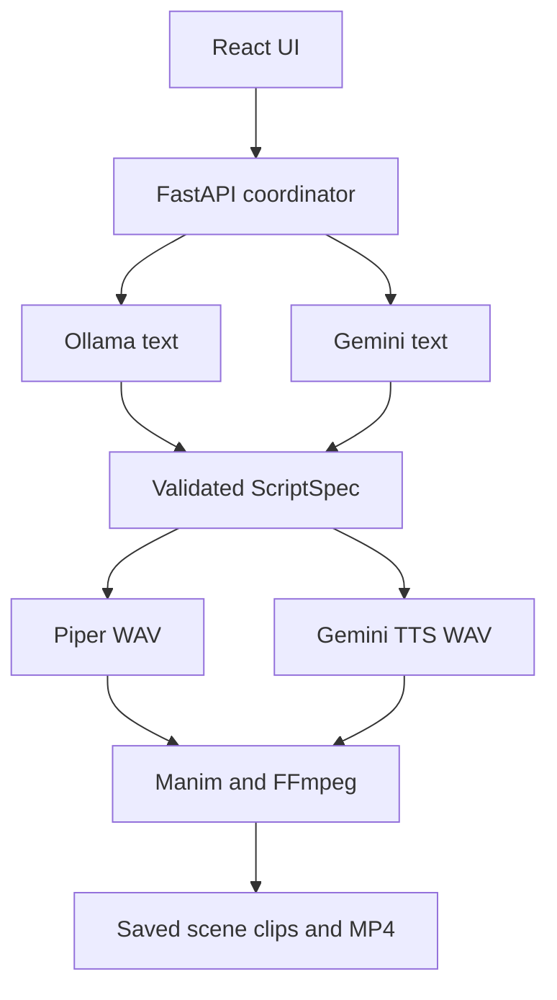

# Prompt-to-Video
## Revised architecture and implementation plan

**Local laptop generation, optional cloud APIs, and the path to interactive lessons**

Version 2.0 · 6 October 2026

### The next release

Let a learner choose **Run on this laptop** or **Use cloud API**. In local mode, Ollama writes the lesson script, Piper creates narration, Manim renders the existing diagram templates, and FFmpeg produces the downloadable MP4. The complete generation pipeline runs on the computer hosting the backend.

Local generation needs no paid inference API or API key after the software, model, voice, and assets are installed. It still uses the learner’s hardware, electricity, storage, and time. Offline operation must be verified; it is not established merely by selecting a local text model.

### What this revision changes

- Uses the completed FastAPI, React, Manim, and FFmpeg implementation as the starting point.
- Adds independent text and narration providers, including a complete local option.
- Defines setup, validation, audio timing, failure recovery, and laptop resource limits.
- Preserves the original interactive-learning goal as a staged extension around saved video clips.
- Makes accounts, a database, uploads, code execution, and a distributed worker later decisions.

### How to use this plan

Sections 1–13 specify the next video-generation release. Sections 14–18 explain how to develop the original learning-platform features without replacing the generator. Sections 19–22 define delivery gates, verification, and implementation examples. Section 23 lists official references.

**Evidence boundary.** The current implementation status is based on the supplied progress summary. The repository was not supplied or audited. New filenames, routes, fields, limits, and schedules below are proposed contracts; adapt them to the actual code before implementation. Technical documentation was checked on 6 October 2026. Hardware and delivery estimates are planning assumptions, not measured results.

<!-- pagebreak -->

# 1. Start from the working MVP

The project currently generates a three-scene narrated video from a prompt. Keep that end-to-end path working throughout the changes.

| Area | Reported implementation | Next change |
| --- | --- | --- |
| FastAPI / main.py | Health, settings, create/list/status/retry, stream and download | Provider discovery, preflight checks, cancellation and clear error codes |
| generator.py | Gemini script, Gemini TTS, Manim, FFmpeg | Provider-neutral orchestration and versioned job configuration |
| manim_renderer.py | Separate rendering subprocess; process, cycle, tree and plot | Preserve templates; enforce timing, limits and consistent output settings |
| visuals.py | Pydantic visual specifications | Reuse as the canonical contract; strengthen semantic checks |
| storage.py | Files in data/<job-id>/; completed artifacts reused | Atomic writes, dependency hashes and restart recovery |
| App.jsx / styles.css | Prompt, settings, polling, player, download and dark styling | Mode selector, model/voice readiness, stage details and recovery actions |
| Runtime | One job at a time; reachable on college WiFi | Keep one job; separate personal laptop and shared-host deployment |

**Already supported visuals:** process flow, cycle, tree, and scatter plot with an optional regression line. Existing icons include sun, plant, water, cloud, and computer. Treat these as an allowlist, not permission to download arbitrary assets.

### Scope reconciliation

The original PDF proposed browser-rendered lessons, browser speech, Supabase, a lesson worker, checkpoints, uploads, and a code runner. Those are not the reported current implementation. Its learning flow remains useful, but its initial architecture and build order need to change.

The next deliverable is **the same video product with local and cloud generation**. Quizzes and progress come after that. Supabase, Redis, Celery, new accounts, and uploads are not prerequisites for local generation.

### Preserve a known working path

Before refactoring, capture one successful job containing a script, narration, scene clips, and final video. Record dependency versions and render settings. Use that job to check the provider refactor without repeatedly spending API calls. Keep the existing cloud model identifiers configurable; this document does not assume which Gemini versions the repository currently uses.

<!-- pagebreak -->

# 2. Define the modes and the compute location

Text generation and narration are separate choices. A local LLM combined with Gemini TTS still needs an API key and network access.

| Product mode | Script | Narration | Rendering | External generation service |
| --- | --- | --- | --- | --- |
| Local | Ollama + downloaded model | Piper + downloaded voice | Backend host | None during generation |
| Cloud API | Existing Gemini adapter | Existing Gemini TTS adapter | Backend host | Gemini |
| Custom, later | User-selected provider | User-selected provider | Backend host | Depends on both selections |

Show two presets initially. Advanced combinations can follow once the two standard paths are reliable. In local mode, reject cloud providers on the backend even if a browser sends a modified request. A local failure must never silently switch to a paid service.

### “My laptop” means the backend is on my laptop

| How the learner opens the app | Computer doing the generation |
| --- | --- |
| Local app at localhost, with local FastAPI, Ollama, Piper and render tools | That learner’s laptop |
| Current WiFi address, http://172.16.40.57:5173 | The computer running the shared backend |
| A future hosted website | The hosted backend, unless a separate local runtime is explicitly connected |

A web page cannot install Ollama or execute the existing Python/Manim pipeline on a visitor’s laptop merely by changing a setting. Calling localhost from a hosted backend also refers to that server, not the visitor’s device.

### Recommended distribution

Ship a locally installed app first: build the React frontend once, serve it through FastAPI, and launch it on loopback. The student installs the local dependencies and downloads one supported model and voice. Node/Vite is needed for development or building the frontend, not necessarily by an end user receiving a prebuilt client.

A desktop installer can later package this setup. A hosted page connected to a local companion is a separate project: it needs explicit pairing, origin checks, authentication, browser permission handling, version negotiation, and a secure transport design. Do not make that bridge a requirement for the next release.

**UI wording:** show the compute host and provider together. A shared-host session should say “Local model on the server,” not “Using your laptop.”

<!-- pagebreak -->

# 3. Architecture that preserves the existing renderer



### Keep provider differences at the edges

The text adapter produces a validated ScriptSpec. The speech adapter produces WAV files and measured durations. Manim and FFmpeg consume these artifacts without needing to know whether Gemini or a local model created them.

| Boundary | Required result |
| --- | --- |
| Text provider → validation | Script data, provider/model identity and bounded diagnostics |
| Validation → speech | Accepted narration and pronunciation settings |
| Speech → timing | Valid WAV, duration, sample rate and channel information |
| Timing → Manim | Valid visual data and a deterministic animation schedule |
| Manim → FFmpeg | Rendered video plus compatible narration files |
| Export → storage/UI | Verified MP4, scene manifest, captions where available, and ready status |

Reuse the current visual schema instead of introducing a competing local-only schema. If schema changes are necessary, version them and migrate through a compatibility adapter.

### Process boundaries

Keep one FastAPI process for the personal app. Run the generation coordinator outside the request event loop, using a dedicated executor or equivalent bounded runner. The heavy rendering and speech work should run in child processes so they can be timed out and stopped.

Ollama is a separate local service. FastAPI calls it through loopback HTTP. React calls FastAPI, not Ollama directly. A separate Piper HTTP server is unnecessary for this MVP; a supervised local Python process can use Piper’s WAV API. [S1, S2, S7]

No model output becomes executable Python, shell commands, HTML, or arbitrary Manim code. The model fills supported templates. The existing renderer remains trusted application code.

<!-- pagebreak -->

# 4. Complete local generation pipeline

| Step | Action | Save before moving on |
| --- | --- | --- |
| 1. Preflight | Check model, voice, render tools, writable storage and local-mode restrictions | Readiness result and dependency identities |
| 2. Accept | Validate prompt; claim the single job slot; snapshot settings | request.json and initial status |
| 3. Outline | Local LLM plans three scenes with a common goal and ordered concepts | outline.json |
| 4. Write scenes | Generate each scene separately, using the outline and a short continuity summary | Candidate scene JSON |
| 5. Validate | Apply schema and semantic checks; allow one content-repair attempt per invalid unit | Accepted script.json and validation result |
| 6. Narrate | Release the app’s LLM residency when practical; Piper creates narration WAVs | WAVs and audio metadata |
| 7. Time | Measure audio and assign animation durations and caption boundaries | timing.json |
| 8. Render | Manim draws each accepted visual specification | Scene animation MP4s |
| 9. Mux | Normalize media and combine each scene’s audio and animation | Playable narrated scene clips |
| 10. Assemble | Concatenate the clips in the saved order | Temporary final MP4 |
| 11. Verify | Check streams, duration and decoding; publish output atomically | video.mp4, manifest.json, ready status |

The browser receives a job ID quickly and polls the existing status endpoint. Generation continues if the tab is closed; it does not survive a stopped backend without recovery logic.

### Keep work small on laptops

Retain three scenes for the first local release. A useful starting narration budget is 45–80 words per scene; actual duration depends on the chosen voice. Generate scripts first, then speech, then video. Avoid running large text inference and Manim renders concurrently.

The local adapter can use one outline call and three scene calls. The existing cloud adapter may keep its current single-script request initially. Both must return the same accepted ScriptSpec before audio begins.

### User-visible progress

Use stage messages such as “Writing scene 2 of 3,” “Creating narration 1 of 3,” and “Rendering scene 3 of 3.” Show elapsed time. Do not invent a precise percentage or remaining-time estimate before measuring representative jobs.

<!-- pagebreak -->

# 5. Laptop setup and model selection

Use Ollama as the first supported local text runtime and Piper as the first supported offline voice engine. Support one tested combination well before adding several runtimes.

| Laptop profile | Starting configuration to evaluate | Limitation |
| --- | --- | --- |
| Around 8 GB RAM | Small 1.7B-class model; short context; 480p preview | Experimental tier; may be slow or fail the content-quality gate |
| Around 16 GB RAM | qwen3:4b-q4_K_M; 8K configured context; 720p output | Recommended initial benchmark target, not a guaranteed minimum |
| Around 24–32 GB RAM or adequate supported GPU memory | Evaluate qwen3:8b-q4_K_M | Larger model may improve content but also consumes more memory and time |

The inspected 4B quantized model download is approximately 2.6 GB; the inspected 8B Q4 model is approximately 5.2 GB. Download size is not runtime RAM usage. Context state, the operating system, browser, and render processes need additional memory. Reserve roughly 15–20 GB free disk as an initial setup allowance, then enforce job-output quotas. [S5, S6]

### First-run sequence

1. Install the project’s tested Python environment, FFmpeg/ffprobe, Manim dependencies and fonts. Preserve the versions that already render the MVP.
2. Install Ollama from its official distribution. Download a selected local model explicitly.
3. Install Piper in the project environment and download a compatible voice.
4. Set Ollama to local-only mode, restart it, and retain its loopback binding. [S3]
5. Start the local app; run one schema probe, one speech sample, and one tiny render.
6. Disconnect the network and run a complete prompt-to-MP4 job.

```bash
ollama pull qwen3:4b-q4_K_M
python -m pip install piper-tts
python -m piper.download_voices en_US-lessac-medium
```

The voice is an example for evaluation. Place its ONNX and configuration files in a known app-managed directory, retain its model card, and confirm licensing before redistribution. Set `OLLAMA_NO_CLOUD=1` in the environment of the Ollama service/application, not only in FastAPI’s environment. [S3, S7, S8]

Pin tested package versions in the release lockfile and record model digests. Do not silently download multi-gigabyte models when Generate is clicked. Show the proposed download size and destination during setup.

<!-- pagebreak -->

# 6. Change the modules in small steps

The names below are a proposed organization; keep equivalent existing helpers if they already provide the boundary.

| File or module | Responsibility |
| --- | --- |
| server/providers/base.py | TextProvider and SpeechProvider contracts; shared error types |
| server/providers/gemini_text.py | Move existing script request code without changing its behavior |
| server/providers/ollama_text.py | Local requests, model discovery, capability probe and response parsing |
| server/providers/gemini_tts.py | Move existing narration calls behind SpeechProvider |
| server/providers/piper_tts.py | Local WAV generation through a supervised speech process |
| server/config.py | Provider selection, secret references, local restrictions and limits |
| server/preflight.py | Check installed assets and versions; return actionable readiness results |
| server/generator.py | Orchestrate the common pipeline; avoid scattered provider conditionals |
| server/visuals.py | Canonical scene/visual schema and semantic validation |
| server/storage.py | Atomic manifests, stage hashes, history and restart recovery |
| server/manim_renderer.py | Trusted templates, explicit timing and subprocess control |
| server/media.py | Probe media, normalize streams, mux and concatenate |
| client/src/components/ | Settings, readiness and status components as App.jsx grows |

### Provider contracts

TextProvider should expose a health/capability check and `generate_script(request, constraints) -> ScriptSpec`. Its internal local implementation can plan and write one scene at a time. Later, add separate methods for assessments and hints using the same provider selection.

SpeechProvider should expose readiness and `synthesize(text, output_path, voice_settings) -> AudioArtifact`. AudioArtifact contains the verified path, duration, sample rate, channels, and engine/voice identity. A sample filename alone is not sufficient evidence of success.

Standardize errors such as PROVIDER_UNAVAILABLE, MODEL_NOT_INSTALLED, INVALID_SCRIPT, OUT_OF_MEMORY, TTS_FAILED, RENDER_FAILED, DISK_FULL, and CANCELLED. Preserve a short safe diagnostic and the failed stage; do not expose secrets or full prompts in logs.

### Refactor order

Wrap existing Gemini calls first. Run the saved baseline through the unchanged downstream stages. Add Ollama next, then Piper, then local settings. This keeps a working endpoint available after each change and makes provider-specific defects easier to isolate.

Do not add a new database, orchestration framework, or generic agent framework for this integration.

<!-- pagebreak -->

# 7. The script and visual contract

Treat the existing Pydantic models as the source of truth. The fields below describe the required meaning; they are not a claim about the current class names.

| Level | Required information |
| --- | --- |
| Script | schema_version, title, language, ordered scenes and source/provenance mode |
| Scene | Stable ID, concept ID, learning goal, narration, visual type and visual specification |
| Visual | One supported process/cycle/tree/plot variant with bounded content |
| Generated metadata | Provider, exact model identity, generation settings and prompt/template version |
| Runtime timing | Measured audio length and assigned animation timings, written by the backend |

Use a discriminated union for visual types if compatible with the existing schema. Reject extra fields where practical. Keep generation metadata and measured timings outside the model’s authority.

### Validate more than JSON syntax

| Visual | Semantic checks |
| --- | --- |
| Process | Unique node IDs; all edges refer to existing nodes; bounded count; ordering compatible with the selected process template |
| Cycle | Valid distinct nodes; intended closed traversal; no accidental disconnected nodes or unsupported extra edges |
| Tree | One root; connected; no cycle; one parent per non-root node; count and depth within layout limits |
| Plot | Finite numeric points; valid increasing axis ranges; bounded point count; labels and units; reject NaN/infinity |

For a regression line, calculate the fit in trusted code from the accepted points. Handle zero x-variance. The model should not invent a visually convincing slope unrelated to those points. Mark synthetic teaching data as illustrative.

### Initial application limits

Use three scenes, up to eight nodes per diagram, tree depth up to four, up to fifty plot points, short labels, and narration capped at 120 words per scene. These are proposed starting limits; revise them only after checking the existing layouts. Fit or wrap labels within a readable font minimum. Reject or simplify content that still overflows.

An invalid scene gets one repair request containing its validation errors and original constraints. If it still fails, stop that stage and offer retry or a supported simpler representation. Never drop a scene, invent missing scientific data, or label a partial output as complete.

Structural validation cannot establish factual accuracy. Review the initial demonstration topics and keep a Report issue action.

<!-- pagebreak -->

# 8. Local LLM generation details

### Discover, probe, then accept jobs

Read installed models through Ollama’s local model-list endpoint. Save the returned digest and quantization details. Inspect the selected model’s capabilities and run a small JSON-schema probe before marking it ready. A model being installed does not prove it can satisfy this application’s output contract. [S4]

Use an explicitly tested tag such as `qwen3:4b-q4_K_M`. Avoid assuming a broad alias always maps to the same model variant. Confirm supported thinking controls; request `think: false` only for a tested configuration that permits it. The reasoning and answer fields are distinct; parse the answer content. [S5, S10]

### Generate small, consistent units

1. Ask for an outline: one teaching goal, three ordered scenes, and the best supported visual for each.
2. Generate each scene with the full outline, relevant source excerpts when available, and a short summary of earlier accepted scenes.
3. Supply the schema, visual limits, language, and narration budget. Treat the user’s material as quoted content, not system instructions.
4. Parse the whole response as JSON and validate it. Do not use regex to salvage a convenient-looking fragment.
5. Repair only the invalid unit once. Save accepted scenes so later failure does not discard them.

Ollama accepts a JSON schema in `format`; Pydantic can produce it with `model_json_schema()`. Validate the answer again with Pydantic after generation. Schema-constrained decoding helps formatting but does not prove correctness. [S1]

### Starting request settings

Use non-streaming JSON for the first implementation. Start testing with an 8K context and a 2K output-token budget per scene; small-memory configurations can use a smaller context and shorter source excerpts. A temperature near 0.2 is an application experiment, not a universal best setting. Tune against the test set.

Budget system instructions + schema + sources + earlier context + reserved output together. Character limits are only a guardrail, not exact token counting. Use a compatible tokenizer when available; otherwise leave a conservative margin. Reject oversized inputs or split them. Detect truncation and do not accept incomplete JSON.

Set bounded connection and generation deadlines; initial values can be 5 seconds to connect and 10 minutes per scene on CPU, with a separate job deadline. Keep a heartbeat while a slow call runs. Save provider timings, not raw private text. [S2]

<!-- pagebreak -->

# 9. Local narration and measured timing

Use Piper to generate a real WAV file that can be embedded in the MP4. Keep Gemini TTS as the cloud alternative. Browser speech is unsuitable as the primary export pipeline because the product needs a saved, reproducible narration artifact.

### Speech implementation

Piper’s Python interface can load a local voice and synthesize directly into a WAV writer. Execute this behind the SpeechProvider boundary, preferably in a supervised subprocess with a bounded lifetime. Cache the loaded voice within that process for all scenes in the job. [S7]

```python
import wave
from piper import PiperVoice

voice = PiperVoice.load(voice_model_path)
with wave.open(output_wav_path, "wb") as wav_file:
    voice.synthesize_wav(narration_text, wav_file)
```

This illustrates the library call only. The adapter must also check the voice/configuration files, enforce a timeout, validate the WAV, and return AudioArtifact. Do not install dependencies or fetch voices inside synthesis.

### Normalize the spoken text

Keep displayed text and spoken text separately. Expand difficult abbreviations deliberately, and convert formulas into readable narration. For example, speak “y equals m times x plus c” while displaying the compact formula. Apply a versioned pronunciation dictionary; do not blindly rewrite all capitalization or symbols.

Use one selected voice and speaking rate across the job. Reject empty text or zero-length audio. Normalize volume consistently without clipping. Record the exact voice files, engine version, and speed settings for retry decisions.

### Timing source of truth

For each scene, measure narration duration D from the generated WAV. Add a short planned lead-in and tail. Align animations to that duration; do not rely only on word counts.

For the first release, distribute the available time across reveal/highlight steps and hold the final diagram until narration finishes. If the sequence cannot fit legibly, simplify the animation or extend the scene with a planned silent hold.

Sentence-level synchronization is a later refinement: generate speech in defined chunks, measure each chunk, and record offsets including inserted pauses. These offsets can drive caption cues and diagram highlights. Do not claim exact word alignment unless an alignment system has been implemented and checked.

Local mode is fully local only when both text and speech providers are local. Saved hints and later assessment generation must obey that rule too.

<!-- pagebreak -->

# 10. Rendering, muxing and export

### Keep the Manim templates deterministic

Pass validated data to the existing process, cycle, tree, and plot renderers. Use fixed application code for layout and animations. Pass inputs through JSON or equivalent data files, not interpolated executable source. Use argument arrays with shell execution disabled.

Configure resolution, frame rate, background, fonts, and renderer explicitly. Keep the current working backend; use the CPU-compatible Cairo path for the local baseline if appropriate. Do not switch renderer automatically. A 720p, 30 fps target and a separate 480p preview preset are reasonable starting profiles. [S11]

Keep text within the frame and use bundled or verified installed fonts. If existing scenes use MathTex, document and test the TeX dependency. Avoid accepting arbitrary model-produced TeX commands. Plain labels should not require a TeX installation.

### Assemble against measured durations

For a scene with narration D, lead-in L, and tail T, use a planned duration of L + D + T. Start the audio after L. Ensure the animation covers the complete spoken content. An approved final-frame hold can fill unused time.

FFmpeg provides video-padding and audio-padding filters. Padding and trimming must follow the planned duration. Do not apply `-shortest` blindly: if animation is too short, it can cut off narration. Detect an unexpected duration mismatch and rerender or pad the intended final hold. [S12]

Normalize every scene to a tested export profile, for example H.264 video, yuv420p pixels, AAC audio, a fixed frame rate, and one audio sample rate/channel layout. Select an available encoder during preflight; do not assume every FFmpeg installation has the same build options.

Concatenate normalized clips in manifest order. Stream-copy concatenation requires compatible streams and time bases; otherwise use a controlled re-encode path. Use trusted generated filenames in the concat list. [S13]

### Verify before marking ready

Probe video/audio streams and positive duration, then run a bounded decode check. Compare final duration with the planned timeline, allowing a small encoder tolerance that is defined and tested. Confirm all three scenes and their final narration sentences are present. Enable MP4 fast-start metadata for browser playback. [S14]

Write to a temporary output and rename it atomically only after verification. Preserve narrated scene clips for the later lesson player; the combined MP4 remains the normal download.

<!-- pagebreak -->

# 11. Retry, cancellation and restart recovery

File existence is not enough to decide that an artifact can be reused. It may belong to a different script, voice, model, or render profile.

| Artifact | Reuse only when these inputs match |
| --- | --- |
| Outline/script | Prompt or source hash, model identity, generation settings, schema and prompt-template versions |
| Narration | Accepted spoken text, voice-file digest, engine version, pronunciation rules and speech settings |
| Timing | Audio identity, measured duration and timing-policy version |
| Animation | Visual data, timing, renderer/template version, fonts/assets and output profile |
| Narrated scene | Video and audio hashes plus mux profile |
| Final MP4 | Ordered narrated-clip hashes plus assembly profile |

Hash canonical serialized inputs. Save checksums and successful validation metadata with each completed artifact. Change a voice and invalidate its audio, timing-dependent animation, narrated clip, and final assembly. Change only resolution and keep accepted text/audio. If the outline changes, invalidate every dependent scene and downstream artifact.

### Job states and ownership

Use running, ready, failed, interrupted, cancelling, and cancelled states, with a separate stage and scene index. Keep the existing API’s naming where possible. Persist state transitions atomically. A proposed stage list is planning, scripting, validating, narrating, timing, rendering, muxing, assembling, and verifying.

For the local release, run one Uvicorn worker and guard acceptance of jobs with the existing single-job lock. Claim the slot before scheduling work. Reject a second job as busy; do not quietly add a queue. A Python in-process lock cannot protect multiple backend processes, so enforce one app instance per data directory as well.

Run the coordinator outside the FastAPI event loop. Do not rely on a request-level background callback for durability; saved manifests provide recovery. More processes or multiple servers require a real ownership/queue design later. [S15]

### Recovery behavior

- On startup, mark incomplete running jobs interrupted and offer Resume. Do not report them as still running.
- Resume from the first invalid or incomplete dependency, using the saved settings. Changed settings create an explicit new revision/job.
- Cancellation signals the coordinator and stops its owned child processes, including descendant render processes on Windows and Unix.
- Cancelling an async wrapper does not necessarily stop its thread or subprocess. Keep ownership until cleanup completes.
- Close an active inference request on cancellation; do not assume socket closure stops inference. Discard late results and keep admission closed until execution stops. If that cannot be confirmed, require an owner-controlled restart of the dedicated runtime before retrying. Do not kill a shared Ollama service or unrelated processes.

<!-- pagebreak -->

# 12. API and frontend changes

The route names here are proposals. Extend equivalent existing endpoints rather than breaking clients.

| Route | Purpose and behavior |
| --- | --- |
| GET /api/providers | Supported provider types and installed local model/voice identifiers |
| GET /api/runtime | Backend-host identity, runtime versions and active-job state |
| POST /api/preflight | Check the selected settings and run bounded capability probes |
| GET /api/settings | Return non-secret settings and whether a cloud key is configured |
| PUT /api/settings | Owner-only configuration changes; validate provider compatibility |
| POST /api/videos | Accept a prompt/settings reference; return 202 and a job ID |
| GET /api/videos/{id} | Status, current stage/scene, safe error, output availability |
| POST /api/videos/{id}/retry | Resume using the persisted configuration and valid artifacts |
| POST /api/videos/{id}/cancel | Request cancellation; report cancelling until stopped |
| GET /api/videos/{id}/stream | Existing playback behavior, including browser seeking |
| GET /api/videos/{id}/download | Download only a verified completed video |

Use a client request ID or idempotency key so a double-click or network retry does not start duplicate work. Use consistent responses: busy, invalid input, missing assets, unavailable provider, and not-ready output should be distinguishable. Do not expose another user’s job ID in a future hosted busy response.

### Settings screen

Show Local and Cloud API presets. For Local, show runtime connection, supported installed models, selected voice, render quality, compute host, and readiness. Hide the requirement for an API key. For Cloud API, keep the existing key setup and show which services receive the prompt or narration.

Store provider endpoints in trusted backend configuration. Do not accept arbitrary model URLs, file paths, commands, or provider endpoints from generation requests. Use validated identifiers from a registry.

### Generation screen

Before Generate, show the mode, host and expected scope of three scenes. During work, show stage, scene, elapsed time and Cancel. On failure, preserve the prompt and show an action such as “Start Ollama,” “Download the selected model,” or “Retry rendering.” Stop status polling at a terminal state and resume it after page refresh using the job ID.

Keep the existing video player and download flow. A failed local job may offer a visible switch to Cloud API, but the user must choose it and supply a key; the backend must never perform that switch automatically.

<!-- pagebreak -->

# 13. Local release and the shared WiFi demo

### Personal laptop release

Build React into static assets and serve them from the local FastAPI application. Bind the backend to 127.0.0.1; keep Ollama on loopback too. Use one app instance, one backend worker, and one generation job. Provide a start script, dependency lockfile, setup guide, and diagnostics report that omits private content.

A useful proposed launch contract is the following, after confirming the repository’s actual import path:

```bash
python -m uvicorn server.main:app \
  --host 127.0.0.1 --port 8000 --workers 1
```

For offline use, bundle frontend assets, fonts, diagram icons, and other runtime resources. Model and voice downloads happen during setup. App generation must not depend on external CDNs, remote authentication, telemetry, or an automatic cloud fallback. Check this with a network-disabled run.

### Existing college WiFi deployment

The shared address is useful for a supervised demonstration. It shares the host’s compute and file store, so it should not be presented as private per-student execution. Without accounts and ownership checks, job IDs do not establish privacy.

Disable remote settings changes and key management in this demo. Permit them only through a verified local owner session. Check the actual connection peer; do not trust an arbitrary forwarded header. CORS is not authentication.

### Protect the local control surface

Use an allowlist of application origins and trusted hosts. Require an app session or local control token for state-changing operations and reject unexpected Origin values. Keep cloud secrets out of responses, persistent browser storage, job manifests, exception traces and version control.

If the key is typed into Settings, it necessarily exists transiently in that browser form. The accurate promise is that the backend stores/uses it without echoing or logging it. Prefer an OS credential store where available; otherwise document local-file permissions and limitations.

Keep local-provider URLs fixed to configured loopback addresses, disable redirects, and avoid proxying local requests through external proxy settings. Restrict all media paths to the current job directory. A Manim subprocess is a process boundary, not a security sandbox.

Before offering unrestricted shared or hosted access, implement authenticated ownership checks and a shared-worker/storage design. Those are separate from enabling the local laptop option.

<!-- pagebreak -->

# 14. Add interactive lessons around saved clips

The original learning goal remains: teach a concept, ask the learner to apply it, offer help, and continue after a clear pass rule. Reuse the generated scene clips to provide this experience.

### Separate two outputs

| Output | Experience |
| --- | --- |
| Downloadable MP4 | A normal video; no enforceable quizzes or progress tracking |
| Interactive lesson in the app | Ordered concept clips, checkpoints, hints, attempts and resume |

Do not claim that a downloaded MP4 can enforce the learning loop. Keep the plain export available, while the app player uses a lesson manifest and narrated clips.

### Player behavior

1. Load the current concept and play its clip or ordered clips.
2. At the end of the final clip, stop and display its checkpoint.
3. Submit an answer to the backend; save the answer and result.
4. On an unsuccessful answer, preserve the draft and show a targeted hint.
5. When the checkpoint passes, unlock Continue. The learner clicks it to start the next concept.
6. Save the confirmed location, activity draft, and completed concept IDs. Restore them after refresh.

Use clip boundaries for the first implementation. This avoids relying solely on a browser time-update event firing at an exact timestamp within a long MP4. Prevent the lesson interface from navigating to locked concepts; the backend remains the authority for recorded progress.

### Start with one reviewed lesson

Add one hand-written checkpoint to a prepared lesson before generating questions with an LLM. Test wrong answers, correct answers, replay, retry and refresh. Then create question generation through the same selected text provider. Freeze the question/rubric version for a learner’s attempts.

The current three-scene video can represent one concept with several scenes, or three short concepts. Add an explicit concept_id instead of assuming a scene always equals a concept. Longer 10–20 minute lessons should be assembled from accepted concepts later, with staged preparation and clear progress.

Provide captions or a transcript, replay, a speed control, and Save and exit. If narration fails, show an explicit recovery state; do not silently skip instruction and mark a concept complete.

<!-- pagebreak -->

# 15. Assessment, hints and progress rules

The backend applies the passing rule. A model may draft questions or suggest feedback, but it does not directly set completion flags.

| Activity | Initial rule | Release order |
| --- | --- | --- |
| MCQ | Selected stable option ID matches the stored answer | First interactive release |
| Matching | All required pairs match saved pairs | Simple extension |
| Short answer | Check a frozen rubric; uncertain evaluations remain ungraded | After a reviewed evaluation set |
| Code completion/debugging | Trusted checker compares isolated execution results with saved tests | After sandbox integration |

For short answers, the original “all essential ideas and at least 80%” policy can be retained as a product rule, but it is not a scientific measure of understanding. Require evidence spans for rubric decisions and compare the grader with teacher-reviewed examples. Small local models may be adequate for hints while still being unreliable graders.

In fully local mode, assessment generation, hint generation, and any AI marking must use the selected local provider. If an installed model fails the grading-quality gate, offer objective questions or self-check feedback instead of making unreliable grading mandatory.

### Retry policy

Save each accepted submission with an idempotent request ID. Keep rubric, weights and essential criteria fixed for the assessment version. Distinguish incorrect answers from provider, network and execution failures; failed services must not count as learner mistakes.

Start with two or three saved hints of increasing detail. Live hints may use the question, failed checks and previous hints. After three unsuccessful attempts, offer replay or a simpler explanation. If a worked solution is revealed, require a fresh equivalent check before recording completion.

### What to record and show

- Completed concepts / total concepts; watching alone does not count.
- First-attempt pass rate, excluding ungraded service failures.
- Attempts and hints used, with a clear “Not checked” state.
- Revision flags after repeated unsuccessful attempts or a revealed solution.

Clear a revision flag after a fresh practice check, not merely after replay. Preserve unfinished answers and allow the learner to leave at any time.

Keep answer keys, hidden tests and worked solutions out of normal lesson responses. A person controlling a local laptop can inspect local files; this is a study tool, not a tamper-proof examination system.

<!-- pagebreak -->

# 16. Add source material after local generation works

Start with the prompt input already implemented, then pasted notes and selectable-text PDFs. Add other inputs after that path is understandable and recoverable.

| Input | Initial behavior |
| --- | --- |
| Topic prompt | Label content as generated without supplied source material |
| Pasted notes / .txt | Preserve headings and source offsets; show a preview |
| Selectable-text PDF | Extract per page; retain page references; flag broken reading order |
| .pptx | Extract text and available notes; retain slide references |
| YouTube reference | Use a user-supplied transcript; store the link as attribution |
| Scans / handwriting | Detect insufficient text and request text or a supported PDF; OCR is later |

pypdf is a text extraction tool, not an OCR engine. A successful extraction call is not evidence that diagrams, reading order, or formulas were captured correctly. [S16]

### Source-to-lesson pipeline

1. Validate the file and extract text in a bounded subprocess.
2. Show extracted content and omissions to the learner.
3. Split on headings and page/slide boundaries while retaining source IDs.
4. Generate an outline and allow the learner to select scope.
5. Supply only relevant excerpts for each concept, within the local model’s context budget.
6. Save references with accepted explanations and questions; verify cited page/slide IDs exist.
7. Generate narration and visuals through the same provider-neutral pipeline.

For small documents, selected sections and simple keyword retrieval are enough. Add local embeddings and a vector index only after document size or retrieval failures justify them. If added to offline mode, the embedding model must also be downloaded and run locally.

### Limits and truthful handling

Begin with 10 MB and 50 pages/slides, plus limits on extracted characters, processing time, memory, and expanded archive size. The byte/page limit alone does not protect parsers. Reject encrypted, corrupt, unsupported or excessively expanded files. Do not execute embedded macros or programs.

Do not infer the content of a YouTube video from its title or URL. Automatic transcripts and OCR are later integrations with their own permissions, dependencies and quality checks. A local model cannot read an unavailable transcript merely because it knows the topic.

In cloud mode, tell the learner which extracted text goes to the provider. In local mode, source extraction, context selection, script generation, narration, and storage must remain on the host.

<!-- pagebreak -->

# 17. Storage now and the hosted architecture later

### File-based personal release

Keep job artifacts under the existing data/<job-id>/ convention. Add versioned manifests and a separate local lesson/progress area when the learning loop is introduced. A small JSON implementation is adequate while one owner and one writer are the actual operating assumptions.

| Record | Minimum saved fields |
| --- | --- |
| Job | ID, request ID, prompt/source reference, settings snapshot, status, stage, timestamps and error |
| Artifact | Relative path, input hash, checksum, dependency versions and verified metadata |
| Lesson | Version, ordered concepts, scene-clip references and source provenance |
| Assessment | Version, question, answer/rubric, hints and frozen passing rule |
| Attempt | Request ID, assessment version, answer, checks, result and time |
| Progress | Completed concept IDs, location, draft, revision flags and last confirmed save |

Write updates to temporary files in the same directory and replace atomically. Serialize concurrent metadata writes. Validate versioned manifests on load. Preserve corrupted files for diagnosis rather than overwriting them with an empty success record.

### When Supabase becomes useful

Use a repository/storage interface now so persistence can change later. Add Supabase when real requirements include accounts, multiple users, cross-device resume, private uploads, or hosted lesson access. That migration introduces authentication, PostgreSQL records, private object storage, ownership checks and backup/deletion rules.

A hosted worker must not depend on ephemeral web-server disk for durable jobs. Store artifacts in durable storage and use database-backed job claims or a queue with lease/heartbeat recovery. Only one worker may own a job attempt at a time. Publish an output manifest atomically so duplicate delivery does not create duplicate lessons.

Do not treat the local in-process lock or JSON files as a multi-server design. Backend ownership checks remain necessary even when storage rules exist; elevated server credentials can bypass normal database policies.

### Keep offline mode independent

The personal installation must not require Supabase sign-in to generate or resume local work. If optional synchronization is added, make upload scope explicit, store remote credentials separately, and resolve version conflicts instead of silently overwriting progress.

Provide deletion of local jobs, sources, media and progress. Do not delete a job while its process is writing. Show disk usage and offer explicit cleanup; do not remove installed models that other applications may use.

<!-- pagebreak -->

# 18. Code activities need a separate execution design

Rendering trusted Manim templates and running a student’s arbitrary Python are different trust boundaries. A subprocess used for rendering does not make arbitrary submitted code safe.

### Hosted code exercises

Use a managed sandbox or a separately operated isolated execution service after the basic lesson loop works. The original Judge0 direction is a candidate, not an assumed installed dependency. Verify the selected host’s isolation, limits and retention behavior before enabling it.

Send only the submitted code and necessary test input. Keep expected results and grading logic in the trusted checker where practical. Never send application keys or mount private source files into an execution environment.

An initial policy to evaluate is 2 seconds CPU, 5 seconds wall time, 128 MB memory, bounded output, restricted process creation, no network, and a fresh disposable filesystem per run. These are proposed service requirements; verify that the selected sandbox actually enforces them.

Freeze test cases, weights and essential tests for an assessment version. Check reference solutions before publishing. Keep hidden-test feedback limited enough that it teaches the mistake without exposing the entire answer key.

### Fully local code exercises

Local code execution is not part of the first offline release. It requires a deliberate sandbox with enforced CPU/memory/process/filesystem/network limits, cross-platform setup, and tests of those limits. A Docker container without a hardened policy is not automatically sufficient.

Until that exists, offer MCQs, matching, code-reading questions, and self-check tasks offline. Do not send code to an external runner under a “fully offline” label. An online code service also has its own costs and availability, independently of LLM costs.

### Failure semantics

Distinguish an incorrect result, syntax/runtime error, resource-limit violation, and unavailable sandbox. A service outage leaves the attempt ungraded and preserves the draft. An endless loop should be terminated within the declared limits; it must not freeze the web server or rendering job.

For code scoring, use passed checks and essential requirements, not the percentage of code lines filled in. Passing three of five equally weighted tests is 60%; whether that passes depends on the frozen rule and essential tests.

This feature should not delay a useful local prompt-to-video release.

<!-- pagebreak -->

# 19. Delivery order from the current MVP

The original five-to-six-week estimate covered a different starting architecture. The schedule below assumes three or four students, a stable current repository, and a six-week planning window. Use the completion gates to decide scope; dates are estimates.

| Stage | Work | Completion gate |
| --- | --- | --- |
| 0 · First 1–2 days | Baseline job, dependency inventory, provider contracts and cloud extraction | Existing cloud video still generates and retries correctly |
| 1 · Week 1 | Ollama discovery, JSON generation, validation, bounded repair and local settings | Supported local model creates accepted scripts for all four visual types |
| 2 · Week 2 | Piper, measured timing, common rendering and complete local setup | Fresh three-scene MP4 generated with network disabled and no key |
| 3 · Week 3 | Dependency hashes, cancellation, restart recovery, resource limits and packaging | Interrupted jobs resume; stale assets are not reused; UI stays responsive |
| 4 · Week 4 | One reviewed interactive lesson, MCQ, hints, attempts and local resume | Wrong answer stays at checkpoint; pass unlocks Continue; refresh restores work |
| 5 · Week 5 | Pasted text and a small selectable-text PDF; source preview and references | Selected source becomes a reviewed lesson with traceable references |
| 6 · Week 6 | Hardware benchmarks, installation checks, two-topic demo and documentation | Release checklist passes on the chosen supported laptop configurations |

### Defer if the six-week window is tight

Prioritize Stages 0–3. Move generated assessments and file inputs later if local setup, output quality or restart recovery is still unreliable. A working local video generator is an independently useful release.

Accounts, cross-device synchronization, production hosting, advanced AI grading, managed code execution, .pptx import, automatic transcripts, OCR, and a hosted-to-local companion are separate later milestones. Do not promise all of them in the same six-week delivery window.

### Suggested work ownership

One contributor owns provider adapters and schemas; one owns audio/video timing and recovery; one owns settings, player and progress; the fourth, if available, owns source extraction, packaging and verification. Agree on contracts first. Integrate through small reviewed changes to the existing code rather than implementing separate pipelines.

**Immediate first task:** extract Gemini text and speech calls into two adapters while preserving one complete working job. Then add Ollama and Piper through those interfaces.

<!-- pagebreak -->

# 20. Release acceptance checks

These checks verify the highest-risk behavior. They are targets for implementation, not claims that the current code has passed them.

| Check | Passing evidence |
| --- | --- |
| Existing cloud path | Prompt produces the same supported output flow after refactoring |
| Fully local generation | After setup, network-disabled prompt produces script, WAVs, scenes and final MP4 without a key |
| Provider policy | Local mode rejects cloud providers; failure never causes an external fallback |
| Missing model or voice | Clear setup action; no partial job reported as ready |
| Four diagram types | Process/cycle/tree/plot all render from accepted bounded specs |
| Invalid JSON / graph | One bounded repair; persistent invalid content stops before rendering |
| Layout and plot correctness | Labels readable; references valid; regression calculated from supplied points |
| Narration timing | Final spoken sentence audible; no clipped endings; scene order correct |
| Retry after render failure | Valid earlier text/audio reused; incomplete scene rerendered |
| Changed voice or model | Changed dependencies invalidate all affected artifacts |
| Double submission | One job accepted; duplicate request returns the original result or status |
| Concurrent request | Second independent request gets busy; first continues normally |
| Responsive server | Health/status work during text inference, speech and rendering |
| Restart and cancellation | Incomplete jobs become interrupted; cancellation cleans owned processes; slot released safely |
| Low memory / full disk | Bounded failure with stage preserved; temporary output not marked complete |
| Local security | Remote settings denied; secrets absent from responses/logs; paths confined to job data |
| Offline assets | Fonts, icons, frontend and voice still work without network |
| Video delivery | Browser play, seek and download work on the supported desktop browsers |
| Learning checkpoint, later | Incorrect answer stays locked; passing unlocks; refresh restores confirmed progress |
| Source import, later | Page references preserved; scans flagged; oversized/corrupt inputs rejected |

### Content review set

Use a fixed set of at least twelve prompts spanning the four visual types, with both computing and non-computing topics. Include long labels, missing context, a plot with constant x-values, and a topic that does not fit the supported visuals.

Review two complete demonstration lessons manually, including narration and answer keys. For unsupported requests, the product should explain the limitation or propose a simpler supported visual, not fabricate an authoritative-looking diagram.

Keep the network-disabled and restart tests as release gates. Do not broaden test coverage indefinitely before delivering the usable local path.

<!-- pagebreak -->

# 21. Performance, cost and operating decisions

### Measure before promising speed

Record hardware/OS, model tag and digest, context/output budgets, voice, render profile, and whether inference uses CPU or GPU. Separate cold model loading from warm inference. Run the same reviewed prompts on the supported laptop profiles.

| Metric | What it resolves |
| --- | --- |
| Time per stage and total elapsed time | Whether script generation or rendering is the actual bottleneck |
| Peak RAM/VRAM and remaining disk | Which laptop profiles are supportable |
| Schema-valid first response and repair rate | Whether the selected model is reliable for this schema |
| Successful video exports / attempted jobs | Operational reliability, with failures categorized |
| Manual factual and visual review | Whether fluent output actually teaches correctly |
| Retry reuse rate and resumed-job outcome | Whether checkpointing saves meaningful work |

Report individual timings or a median/range for a small sample. Use percentile latency only when the sample size supports it. Include failed jobs and cold starts rather than reporting only the fastest successful run.

### Practical resource controls

Keep one generation job active. Release the app’s selected LLM from memory after text generation where supported; verify cancellation and unloading behavior on the pinned runtime. Cap speech/render subprocess concurrency and worker threads, leave memory for the operating system, and avoid overlapping heavy stages. Do not unload models used by unrelated applications without an explicit ownership policy.

If the model does not fit, offer a tested smaller model or a lower-memory configuration. If rendering is slow, offer a lower-resolution preview. Neither change should secretly reduce conceptual correctness or cut narration.

### Cost wording

Local mode avoids per-request text and speech API charges. It does not provide free hardware, electricity, storage, hosting, or an online code runner. Cloud mode remains subject to the selected provider’s current quotas and prices. Do not promise that a free tier will cover every user.

### Distribution inventory

Retain package versions, model and voice checksums, model cards, and notices for bundled dependencies. The current Piper project declares GPL-3.0, and voice models have their own licensing information. Confirm the distribution obligations of the chosen app bundle and voice before publishing an installer. FFmpeg build options also affect the components being distributed. [S8, S9]

**Release promise:** a supported laptop can generate bounded educational videos locally after setup, with explicit quality and hardware limits. Broader subject coverage and automatic grading require their own evidence.

<!-- pagebreak -->

# 22. Implementation examples

These examples show proposed contracts. They need adaptation to the actual repository; they are not drop-in code or an implemented feature.

### Persisted non-secret job configuration

```json
{
  "mode": "local",
  "text_provider": "ollama",
  "text_model": "qwen3:4b-q4_K_M",
  "speech_provider": "piper",
  "voice_id": "en_US-lessac-medium",
  "scene_count": 3,
  "language": "en",
  "render_profile": "720p30",
  "allow_cloud_fallback": false,
  "schema_version": "2",
  "prompt_template_version": "local-v1"
}
```

The backend adds the actual model/voice digests, installed dependency versions and configuration hash. Do not invent a digest, let the model supply it, or write API keys into this object. Validate mode and provider compatibility server-side.

### Minimal Ollama request shape

```python
payload = {
    "model": selected_model,
    "messages": scene_messages,
    "format": SceneSpec.model_json_schema(),
    "stream": False,
    "think": False,  # only for a tested supported model
    "options": {
        "num_ctx": 8192,
        "num_predict": 2048,
        "temperature": 0.2,
    },
    "keep_alive": "5m",
}
# POST payload to the trusted loopback /api/chat endpoint.
# Check HTTP status, completion and deadline before parsing.
scene = SceneSpec.model_validate_json(
    response_data["message"]["content"]
)
```

`SceneSpec` and the message builder must come from the app’s real schema and prompt code. Add explicit HTTP timeouts, bounded response size, cancellation, semantic validation, safe error mapping and one repair attempt around this call. `think` support must be checked; it is not interchangeable across models. [S1, S2, S10]

<!-- pagebreak -->

# 23. References and implementation notes

Official sources checked on 6 October 2026. They support external API/library behavior; design limits, architecture choices and schedules in this plan are project recommendations. Pin the versions tested in the repository rather than assuming future documentation remains unchanged.

| Ref. | Source and use |
| --- | --- |
| S1 | Ollama, Structured Outputs — JSON schemas and Pydantic validation. https://docs.ollama.com/capabilities/structured-outputs |
| S2 | Ollama, Chat API — request fields, completion metadata and residency. https://docs.ollama.com/api/chat |
| S3 | Ollama, FAQ — loopback binding, local-only controls and service environment. https://docs.ollama.com/faq |
| S4 | Ollama, List Models — local inventory and digest metadata. https://docs.ollama.com/api/tags |
| S5 | Ollama, Qwen3 4B Q4 model — explicit tag and artifact size. https://ollama.com/library/qwen3:4b-q4_K_M |
| S6 | Ollama, Qwen3 tags — available variants and approximate download sizes. https://ollama.com/library/qwen3/tags |
| S7 | Piper, Python API — loading a voice and writing WAV audio. https://github.com/OHF-Voice/piper1-gpl/blob/main/docs/API_PYTHON.md |
| S8 | Piper, Voices — required model/configuration files and voice-specific information. https://github.com/OHF-Voice/piper1-gpl/blob/main/docs/VOICES.md |
| S9 | Piper project — local speech engine and declared project license. https://github.com/OHF-Voice/piper1-gpl |
| S10 | Ollama, Thinking — discover supported controls and separate reasoning/answer fields. https://docs.ollama.com/capabilities/thinking |
| S11 | Manim Community, Configuration — explicit renderer and output settings. https://docs.manim.community/en/stable/guides/configuration.html |
| S12 | FFmpeg, Filters — padding, trimming and media transformations. https://ffmpeg.org/ffmpeg-filters.html |
| S13 | FFmpeg, Formats — concat input compatibility and timestamp handling. https://ffmpeg.org/ffmpeg-formats.html |
| S14 | ffprobe documentation — media stream and format inspection. https://ffmpeg.org/ffprobe.html |
| S15 | FastAPI, Background Tasks — background work and multi-process caveats. https://fastapi.tiangolo.com/tutorial/background-tasks/ |
| S16 | pypdf, Extract Text — text extraction limits and OCR distinction. https://pypdf.readthedocs.io/en/stable/user/extract-text.html |

### Project inputs

The attached twelve-page System Architecture Document supplies the original learning-platform goals. The supplied “What’s Done — Prompt-to-Video MVP” summary supplies the current implementation baseline. This revision preserves the original educational flow while replacing the obsolete initial generation architecture with the pipeline already built.
